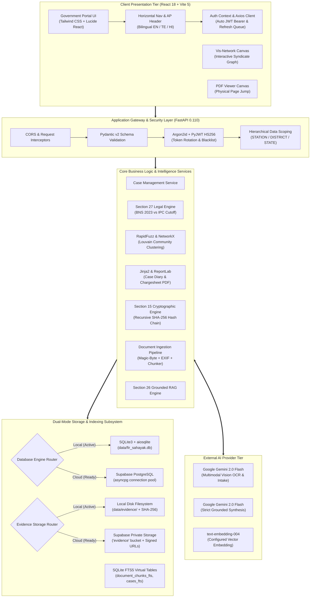
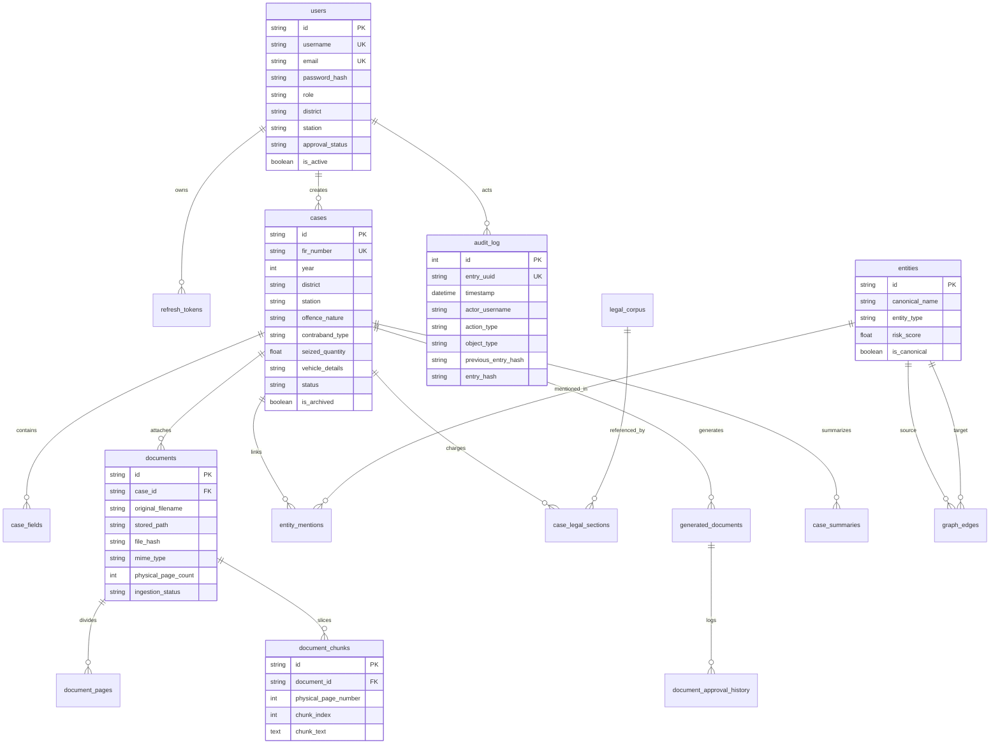

# FIR Sahayak — AI-Enabled Unified First Information Report (u-FIR) and Case Intelligence Platform
**Department:** Andhra Pradesh Prohibition & Excise Department  
**Version:** 2.0 (Local Prototype / Supabase Cloud-Ready)  
**Inspection Date:** October 15, 2026  
**Target Repository:** [https://github.com/doddasurendra/FIR_Sahayak](https://github.com/doddasurendra/FIR_Sahayak)  
**Execution Environment:** Windows 11 / Python 3.12 / FastAPI 0.110 / React 18 / Vite 5  

---

## Table of Contents
1. [Executive Project Overview](#1-executive-project-overview)
2. [End-to-End System Architecture](#2-end-to-end-system-architecture)
3. [Frontend Architecture & Module Analysis](#3-frontend-architecture--module-analysis)
4. [Backend Architecture & Complete API Inventory](#4-backend-architecture--complete-api-inventory)
5. [Database Architecture & Entity-Relationship Model](#5-database-architecture--entity-relationship-model)
6. [Supabase PostgreSQL & Cloud Infrastructure Status](#6-supabase-postgresql--cloud-infrastructure-status)
7. [Multi-Format Upload, OCR & Document Processing Pipeline](#7-multi-format-upload-ocr--document-processing-pipeline)
8. [Artificial Intelligence Models & Provider Integrations](#8-artificial-intelligence-models--provider-integrations)
9. [Grounded Retrieval-Augmented Generation (RAG) Architecture](#9-grounded-retrieval-augmented-generation-rag-architecture)
10. [Security, Cryptography & Governance](#10-security-cryptography--governance)
11. [Case Intelligence & Specialized Forensic Modules](#11-case-intelligence--specialized-forensic-modules)
12. [Deployment, Operations & Infrastructure](#12-deployment-operations--infrastructure)
13. [Backups & Disaster Recovery](#13-backups--disaster-recovery)
14. [Performance, Cost Analysis & Scalability Roadmap](#14-performance-cost-analysis--scalability-roadmap)
15. [Quality Assurance, Testing & Verification Report](#15-quality-assurance-testing--verification-report)
16. [Limitations & Production Readiness Assessment](#16-limitations--production-readiness-assessment)
17. [Manager Presentation Scripts](#17-manager-presentation-scripts)
18. [55 Comprehensive Manager Technical Interview Questions & Answers](#18-55-comprehensive-manager-technical-interview-questions--answers)
19. [Technical Glossary & Architecture Recommendations](#19-technical-glossary--architecture-recommendations)

---

## 1. Executive Project Overview

FIR Sahayak is an enterprise-grade First Information Report (u-FIR) intelligence platform engineered specifically for the Andhra Pradesh Prohibition & Excise Department. The application addresses operational challenges in illicit distillation (ID liquor), interstate smuggling, non-duty paid liquor (NDPL) trafficking, and cannabis (ganja) contraband enforcement across Andhra Pradesh's 26 districts.

The system transitions traditional manual, handwritten, and fragmented FIR workflows into a unified digital intelligence pipeline. It integrates tri-modal case intake (typed narrative, voice transcription, and physical document OCR), strict grounded Retrieval-Augmented Generation (RAG) with verifiable physical page citations, statutory legal section recommendation matching the newly enacted Bharatiya Nyaya Sanhita (BNS 2023) and AP Excise Act 1968, automated entity resolution for criminal syndicates, and court-ready Case Diary (Section 172 CrPC/BNSS) and Chargesheet (Section 173 CrPC/193 BNSS) generation.

Currently, FIR Sahayak operates as a fully functional, locally verified PC-first prototype with comprehensive offline readiness. It uses a dual-adapter architecture capable of running entirely offline on local SQLite with FTS5 virtual tables and local disk storage, while having full production-ready adapters for Supabase PostgreSQL and private cloud object storage. All 29 unit and integration tests are passing.

### 1.1 Project Identity & Core Problem
- **Official Application Name:** FIR Sahayak — AI-Enabled Unified First Information Report (u-FIR) and Case Intelligence Platform
- **Jurisdictional Beneficiary:** Andhra Pradesh Prohibition & Excise Department, Government of Andhra Pradesh.
- **Problem Statement:** Excise station officers face acute documentation bottlenecks when seizing illicit distillation (ID) liquor, interstate non-duty paid liquor (NDPL), vehicles, and cannabis contraband. Traditional handwritten FIR processing is slow, siloed within local station house diaries, and vulnerable to charging errors during the legal transition from the Indian Penal Code (IPC 1860) to the Bharatiya Nyaya Sanhita (BNS 2023). Furthermore, repeat interstate smuggling syndicates operating across district borders evade detection due to lack of cross-station link analysis.
- **Strategic Objectives:**
  1. *Tri-Modal Intake:* Rapidly capture seizure facts via spoken Telugu/English voice audio, raw typed narratives, or photographs of handwritten FIRs.
  2. *Strict Grounded RAG:* Provide AI copilot answers strictly grounded in uploaded evidence documents with verifiable physical page citations, completely eliminating AI hallucinations.
  3. *Statutory Legal Decision Support:* Automatically evaluate AP Excise Act 1968 sections alongside BNS 2023 or IPC based on offence date regimes.
  4. *Syndicate Network Intelligence:* Algorithmic entity resolution linking co-accused persons and shared conveyances across cases using graph clustering.
  5. *Court-Admissible Draft Generation:* Automatically render Section 172 CrPC/BNSS Case Diaries and Section 173 CrPC/193 BNSS Chargesheets with draft watermarks.
  6. *Tamper-Evident Accountability:* Maintain an unbroken recursive SHA-256 cryptographic audit hash chain logging every read, write, override, and login event.

### 1.2 User Hierarchy & Personas
The platform defines three strictly scoped operational roles across Andhra Pradesh's 26 districts:
1. **STATION Officer (Excise Sub-Inspector / Station Inspector):** Confined exclusively to their assigned station (e.g. *Kurnool Town Station*). Can create case drafts, upload evidence, review extractions, perform grounded document RAG, and generate case diaries.
2. **DISTRICT Administrator (Superintendent of Excise / District Nodal Officer):** Oversees all stations within their assigned district (e.g. *Kurnool District*). Has supervisory review powers, can approve self-registered station officers, review entity deduplication queues, and analyze district-wide contraband trends.
3. **STATE Director (Commissioner of Prohibition & Excise / State Nodal Admin):** Maintains unrestricted statewide visibility across all 26 districts and state headquarters (Amaravati). Analyzes multi-district syndicate networks, manages statewide officer provisioning, and inspects the cryptographic audit trail.

### 1.3 Implementation Status & Reality Check
- **Current Operating Mode:** Fully functional, locally runnable PC-first prototype with comprehensive offline readiness.
- **Dual-Storage Strategy:** The codebase implements a complete dual-adapter pattern. In the current local environment, it runs offline on **SQLite 3 with FTS5** full-text search and local disk evidence storage (`data/evidence/`). When cloud credentials are provided in `.env`, it seamlessly connects to **Supabase PostgreSQL** and **Supabase Private Object Storage** without code changes.
- **Automated Verification:** All **29 automated unit and integration tests** are passing (`29 passed in 10.73s`).
- **Production Status:** The application is a high-fidelity departmental demonstration prototype. It is **not** yet officially integrated with the High Court CCTNS network, legally certified by judicial authorities, or deployed to the Andhra Pradesh State Data Centre (APSDC).


## 2. End-to-End System Architecture

The system uses a decoupled, event-audited, tiered architecture:


### 2.1 Complete Evidence Upload & RAG Question Lifecycle Walkthrough
To illustrate how all layers cooperate in practice, consider the complete lifecycle when an officer photographs a handwritten FIR memo, uploads it, and asks an authorized query:

1. **User Action & File Selection:**
   - The officer navigates to `/intake` (New Case Intake) or `/ai-fir-assistance` and selects a smartphone photograph (`seizure_memo.jpg`, 3.2 MB).
2. **Frontend Pre-Validation:**
   - React's `onChange` event in `NewCaseIntake.tsx` checks the file type against allowed extensions (`.pdf, .jpg, .jpeg, .png, .webp`). It instantly initializes a temporary blob preview via `URL.createObjectURL()` so the officer can inspect image legibility.
3. **Multipart Request Transmission:**
   - An Axios `multipart/form-data` POST request is dispatched to `/api/v1/documents/upload`. The Axios request interceptor detects `FormData` and strips the manual `Content-Type` header, allowing the browser to calculate the boundary. The officer's JWT token is injected into `Authorization: Bearer <token>`.
4. **Backend Ingestion & Magic-Byte Validation:**
   - FastAPI receives the upload stream. In `backend/app/api/v1/documents.py`, `_detect_mime_type()` inspects the raw initial bytes. It detects `ÿØÿ`, identifying genuine JPEG data regardless of the filename. Disguised executables or corrupted text files are rejected with HTTP 400.
5. **Cryptographic Hashing & Physical Storage:**
   - `StorageService.upload_file()` calculates the SHA-256 digest of the entire file (e.g. `e3b0c442...`). Since cloud environment variables are unconfigured, it saves the binary file to `data/evidence/e3b0c442_seizure_memo.jpg`.
6. **Multimodal OCR & Normalization:**
   - `PDFPipeline.process_image()` opens the image using Pillow and applies `ImageOps.exif_transpose()` to ensure correct vertical orientation. It dispatches the image to `GeminiService.extract_text_from_image()`, where Gemini 2.0 Flash transcribes both printed English and handwritten Telugu into structured text.
7. **Chunking & Full-Text Search Indexing:**
   - The transcribed text is treated as Physical Page 1. It is sliced into 400-character text chunks with 80-character overlaps. These chunks are inserted into the relational `document_chunks` table and simultaneously indexed into the `document_chunks_fts` SQLite FTS5 virtual table using unicode61 multi-language tokenization.
8. **Relational Metadata & Audit Event:**
   - A `Document` row is saved in the database with status `COMPLETED`. An audit event `DOCUMENT_UPLOADED` is appended to `audit_log`, cryptographically linked to the previous entry hash.
9. **Officer Formulates Authorized Query:**
   - The officer opens `/ai-fir-assistance`, selects the newly uploaded document, and types in Mode A: *"What quantity of ID liquor was seized and from which vehicle?"*
10. **Document-Isolated Retrieval:**
    - The backend `POST /api/v1/rag/query` validates that the officer's jurisdiction allows access to the document. `RAGEngine.answer_pdf_only()` queries `document_chunks_fts` filtering strictly by `document_id = :doc_id`. No chunks from any other case can be returned.
11. **Grounded Answer Synthesis & Citation Binding:**
    - The retrieved text snippet (containing *"seized 45.0 Litres of ID liquor from Bajaj auto AP21TX1234"*) is passed to Gemini with a rigid prompt instructing: *Answer strictly using the provided context. Attach page citations.*
12. **Response Delivery & Interactive Verification:**
    - The backend returns the answer and citation metadata. The frontend renders the response with a clickable `[Page 1]` button. Clicking the button opens `PDFViewerModal`, allowing the officer to visually cross-verify the AI's answer directly against the original document canvas.


## 3. Frontend Architecture & Module Analysis

The frontend is engineered as an enterprise-grade Single Page Application (SPA) built with:
- **Framework:** React 18.2.0 with TypeScript 5.2.2.
- **Build Engine:** Vite 5.1.6 with `@vitejs/plugin-react`.
- **CSS Architecture:** Tailwind CSS 3.4.1 with PostCSS and custom Andhra Pradesh portal color extensions (`govblue` #1e40af, `govemerald` #059669).
- **Typography:** Multi-language typography importing Google Fonts (`Inter`, `Noto Sans Telugu`, `Noto Sans Devanagari`).
- **Graph Visualization:** `vis-network` 9.1.9 for interactive physics-based criminal syndicate network diagrams.
- **Iconography:** `lucide-react` 0.359.0.

### 3.1 Exhaustive Page-by-Page Audit (All 17 Page Components)
#### `Login.tsx`
- **Route:** `Root (`/` when unauthenticated)`
- **Authorized Roles:** `Public`
- **Functionality:** Tabbed portal authentication: Officer Sign-In, 26-district self-registration with jurisdiction validation, password reset request, and 1-click Quick Demo Role Switcher (DEV, STATION, DISTRICT, STATE). Official AP Government branding emblem displayed prominently.

#### `Dashboard.tsx`
- **Route:** ``/``
- **Authorized Roles:** `STATION, DISTRICT, STATE`
- **Functionality:** Role-scoped departmental command center. Displays real-time scoped KPIs: Total Active Cases, Under Review, Approved Cases, Contraband Seizure breakdown by volume/units, and action item alerts for pending human overrides and unmerged entities.

#### `CaseManagement.tsx`
- **Route:** ``/cases``
- **Authorized Roles:** `STATION, DISTRICT, STATE`
- **Functionality:** Searchable, filterable repository of u-FIR records within active jurisdiction. Supports multi-field free text search across FIR number, accused names, contraband type, and vehicle numbers. Filters by status (DRAFT, IN_REVIEW, APPROVED, ARCHIVED).

#### `CaseDetail.tsx`
- **Route:** ``/cases/:id``
- **Authorized Roles:** `STATION, DISTRICT, STATE`
- **Functionality:** Comprehensive single-case dossier. Sections: (1) Seizure particulars, (2) Linked entities & conveyances, (3) Evidence documents with built-in viewer, (4) AI field provenance with interactive human override modal and electronic sign-off.

#### `NewCaseIntake.tsx`
- **Route:** ``/intake``
- **Authorized Roles:** `STATION, DISTRICT, STATE`
- **Functionality:** Tri-modal case intake pipeline: Typed narrative extraction, voice audio transcription (TE/EN/HI), and multi-format evidence upload (PDF/JPG/PNG/WEBP). Automatically extracts 12 structured fields into an editable draft review form requiring officer sign-off.

#### `AICaseSummaries.tsx`
- **Route:** ``/summaries``
- **Authorized Roles:** `STATION, DISTRICT, STATE`
- **Functionality:** Generates grounded 3-to-5 sentence executive case briefs in English, Telugu, or Hindi. Results are cached in the `case_summaries` database table to eliminate redundant LLM API calls, with a manual 'Regenerate' option.

#### `LegalSectionAssistance.tsx`
- **Route:** ``/legal``
- **Authorized Roles:** `STATION, DISTRICT, STATE`
- **Functionality:** Section 27 Date-Aware Statutory Recommendation Engine. Evaluates BNS 2023 vs IPC 1860 based on July 1, 2024 cutoff, evaluates AP Excise Act 1968 provisions (34a, 34b, 37A, 45), checks essential ingredients, flags missing elements, and logs officer accept/reject decisions.

#### `EntityNetwork.tsx`
- **Route:** ``/network``
- **Authorized Roles:** `STATION, DISTRICT, STATE`
- **Functionality:** Interactive syndicate network graph rendered with `vis-network`. Displays criminal associations, shared vehicles, Louvain community clusters, and side profile inspector. Disclaims leads as analytical aids rather than autonomous judicial proof.

#### `EntityReviewQueue.tsx`
- **Route:** ``/entity-review``
- **Authorized Roles:** `DISTRICT, STATE`
- **Functionality:** Suspect entity deduplication queue. Compares candidate duplicate pairs flagged by RapidFuzz string distance (similarity 70%-98%). Allows authorized administrators to keep records separate or merge into a single canonical profile.

#### `CaseDiaryGenerator.tsx`
- **Route:** ``/case-diary``
- **Authorized Roles:** `STATION, DISTRICT, STATE`
- **Functionality:** Investigation Case Diary generator adhering to Section 172 CrPC/BNSS. Populates statutory Jinja2 templates, provides multi-version draft editing, supervisory approvals, and exports watermarked official PDFs via ReportLab.

#### `ChargesheetGenerator.tsx`
- **Route:** ``/chargesheet``
- **Authorized Roles:** `STATION, DISTRICT, STATE`
- **Functionality:** Formal Court Chargesheet generator conforming to Section 173 CrPC/193 BNSS. Structured legal format compiling accused particulars, seizure memos, witness statements, and accepted legal sections into an official watermarked court filing PDF.

#### `AIFIRAssistance.tsx`
- **Route:** ``/ai-fir-assistance``
- **Authorized Roles:** `STATION, DISTRICT, STATE`
- **Functionality:** Grounded investigative copilot. Mode A (PDF-Only) strictly scopes retrieval to the selected FIR PDF with clickable physical page citations; Mode B (Cross-Case) executes SQL aggregations and jurisdiction synthesis; Mode C handles single-page images.

#### `BulkIngestion.tsx`
- **Route:** ``/bulk-ingestion``
- **Authorized Roles:** `DISTRICT, STATE`
- **Functionality:** Batch import tool for legacy FIR datasets in CSV or JSON format. Saves file, computes SHA-256 hash, and polls background ingestion progress every 4 seconds, displaying real-time success, failure, and error logs.

#### `EmployeeManagement.tsx`
- **Route:** ``/employees``
- **Authorized Roles:** `DISTRICT, STATE`
- **Functionality:** Departmental officer governance. (1) Directory of active officers, (2) Pending self-registration approvals/rejections with audit justification prompt, (3) Account provisioning modal with AP jurisdiction dropdowns, (4) Admin password reset.

#### `AuditTrail.tsx`
- **Route:** ``/audit-trail``
- **Authorized Roles:** `DISTRICT, STATE`
- **Functionality:** Section 15 Tamper-Evident SHA-256 Recursive Cryptographic Hash Chain. Displays sequential log blocks with actor, action, object, and previous/current hash digests. Includes 'Verify Cryptographic Hash Chain' button recalculating all links.

#### `ReportsAnalytics.tsx`
- **Route:** ``/reports``
- **Authorized Roles:** `STATION, DISTRICT, STATE`
- **Functionality:** Section 17 Explainable Repeat-Offender Analytics & Risk Scoring. Displays recidivism risk ranking (HIGH, MEDIUM, LOW) based on multi-case involvement, cross-district activity, and contraband severity, with transparent contributing factors.

#### `SettingsHealth.tsx`
- **Route:** ``/settings``
- **Authorized Roles:** `STATION, DISTRICT, STATE`
- **Functionality:** System diagnostics and disaster recovery console. Live checks for FastAPI backend, SQLite+FTS5 database, and Gemini LLM provider. Displays storage directory paths, backup protocols, and local recovery guidance.


## 4. Backend Architecture & Complete API Inventory

The backend is engineered on:
- **Framework:** FastAPI 0.110.0 running on Uvicorn ASGI server and Python 3.12.
- **ORM:** SQLAlchemy 2.0.28 with asynchronous session factories (`AsyncSessionLocal` using `aiosqlite`) and synchronous sessions for table creation.
- **Data Validation:** Pydantic v2 schemas strictly validating all request and response bodies.
- **Security:** `argon2-cffi` 23.1.0 for password hashing, `PyJWT` 2.8.0 for cryptographic token generation.
- **Algorithms:** `rapidfuzz` 3.6.1 for fuzzy entity matching, `networkx` 3.2.1 for Louvain community graph clustering.
- **Templating & PDF Compilation:** `jinja2` 3.1.3 and `reportlab` 4.1.0.

### 4.1 Complete API Endpoint Inventory (All 50 Endpoints)
| Endpoint | Method | Purpose | Authentication | Role Restrictions | Data / Storage Interaction | Verification Status |
|---|---|---|---|---|---|---|
| `/api/v1/auth/login` | **POST** | Officer authentication; returns JWT access and refresh tokens | Public | None | Reads users, writes refresh_tokens & audit_log | Verified (Unit & Live Test) |
| `/api/v1/auth/register` | **POST** | Officer self-registration; validates AP jurisdiction | Public | Auto-approves STATION; PENDING for DISTRICT/STATE | Writes users & audit_log | Verified (Unit Test) |
| `/api/v1/auth/refresh` | **POST** | Rotates refresh token and issues new access token | Refresh JWT | None | Updates refresh_tokens table | Verified (Unit Test) |
| `/api/v1/auth/forgot-password` | **POST** | Submits password reset request | Public | None | Reads users table | Verified (Informational) |
| `/api/v1/auth/me` | **GET** | Retrieves current authenticated officer profile | Bearer JWT | All roles | Reads users table | Verified (Live Test) |
| `/api/v1/employees/` | **GET** | Lists departmental officers scoped to jurisdiction | Bearer JWT | Role-scoped (STATION/DISTRICT/STATE) | Reads users table | Verified (Live Test) |
| `/api/v1/employees/` | **POST** | Provisions new officer account | Bearer JWT | DISTRICT (for Station) or STATE (all) | Writes users & audit_log | Verified (Unit Test) |
| `/api/v1/employees/{id}/approve` | **POST** | Approves pending officer registration | Bearer JWT | DISTRICT or STATE | Updates users & audit_log | Verified (Unit Test) |
| `/api/v1/employees/{id}/reject` | **POST** | Rejects pending officer registration with reason | Bearer JWT | DISTRICT or STATE | Updates users & audit_log | Verified (Unit Test) |
| `/api/v1/employees/{id}/reset-password` | **POST** | Admin-initiated password reset | Bearer JWT | DISTRICT or STATE | Updates users & audit_log | Verified (Unit Test) |
| `/api/v1/employees/{id}/toggle-status` | **PUT** | Activates/deactivates officer account | Bearer JWT | DISTRICT or STATE | Updates users & audit_log | Verified (Unit Test) |
| `/api/v1/cases/` | **GET** | Searches and filters u-FIR case records | Bearer JWT | Role-scoped data filter | Reads cases table | Verified (Unit & Live Test) |
| `/api/v1/cases/{id}` | **GET** | Retrieves comprehensive case dossier and evidence | Bearer JWT | Role-scoped jurisdiction check | Reads cases, case_fields, documents | Verified (Live Test) |
| `/api/v1/cases/` | **POST** | Creates new FIR case record and accused entities | Bearer JWT | Role-scoped (creates in own station) | Writes cases, case_fields, entities, audit | Verified (Unit & Live Test) |
| `/api/v1/cases/{id}` | **PUT** | Updates case particulars and metadata | Bearer JWT | Role-scoped | Updates cases & audit_log | Verified (Live Test) |
| `/api/v1/cases/{id}/fields/{fid}/override` | **POST** | Records officer override of AI-extracted field | Bearer JWT | Role-scoped | Updates case_fields & audit_log | Verified (Unit Test) |
| `/api/v1/cases/{id}` | **DELETE** | Soft-deletes/archives case record with reason | Bearer JWT | Role-scoped | Updates cases table & audit_log | Verified (Unit Test) |
| `/api/v1/documents/upload` | **POST** | Multi-format evidence upload (PDF/JPG/PNG/WEBP) | Bearer JWT | Role-scoped | Writes documents, document_chunks, FTS5 | Verified (Unit & Live Test) |
| `/api/v1/documents/` | **GET** | Lists ingested evidence documents | Bearer JWT | Role-scoped | Reads documents table | Verified (Live Test) |
| `/api/v1/documents/{id}/pages` | **GET** | Lists physical pages and OCR extraction text | Bearer JWT | Role-scoped | Reads document_pages table | Verified (Live Test) |
| `/api/v1/documents/{id}/view` | **GET** | Returns signed URL or authenticated file stream | Bearer JWT | Role-scoped | Reads filesystem / Supabase Storage | Verified (Live Test) |
| `/api/v1/documents/storage-status` | **GET** | Diagnostic check of cloud and local storage | Bearer JWT | All roles | Checks storage adapter readiness | Verified (Unit Test) |
| `/api/v1/extraction/narrative` | **POST** | Gemini AI structured extraction from raw text | Bearer JWT | All roles | External Gemini API (with regex fallback) | Verified (Live Test) |
| `/api/v1/extraction/voice` | **POST** | Tri-modal audio intake and structured extraction | Bearer JWT | All roles | Simulated audio transcript + Gemini NLP | Verified (Live Test) |
| `/api/v1/legal/recommend/{case_id}` | **GET** | Evaluates BNS/IPC and AP Excise Act sections | Bearer JWT | All roles | Reads legal_corpus & cases table | Verified (Unit Test) |
| `/api/v1/legal/search` | **GET** | Full-text search across legal statutes | Bearer JWT | All roles | Reads legal_corpus_fts / legal_corpus | Verified (Live Test) |
| `/api/v1/legal/decision` | **POST** | Records officer acceptance/rejection of charge | Bearer JWT | Role-scoped | Writes case_legal_sections & audit_log | Verified (Unit Test) |
| `/api/v1/legal/case/{case_id}/sections` | **GET** | Lists charges linked to case | Bearer JWT | Role-scoped | Reads case_legal_sections table | Verified (Live Test) |
| `/api/v1/entities/` | **GET** | Lists canonical accused/vehicle entities | Bearer JWT | All roles | Reads entities table | Verified (Live Test) |
| `/api/v1/entities/review-queue` | **GET** | Duplicate candidate pairs via RapidFuzz | Bearer JWT | All roles | Computes token sort ratio on entities | Verified (Live Test) |
| `/api/v1/entities/merge` | **POST** | Merges duplicate entities into canonical profile | Bearer JWT | DISTRICT or STATE | Updates entities, mentions, edges, audit | Verified (Unit Test) |
| `/api/v1/entities/network-graph` | **GET** | Constructs graph with Louvain syndicate clusters | Bearer JWT | All roles | Builds NetworkX graph from graph_edges | Verified (Unit Test) |
| `/api/v1/entities/{id}` | **GET** | Retrieves entity profile and linked cases | Bearer JWT | All roles | Reads entities and entity_mentions | Verified (Live Test) |
| `/api/v1/generation/draft` | **POST** | Generates draft Case Diary or Chargesheet | Bearer JWT | Role-scoped | Jinja2 templates; writes generated_documents | Verified (Unit Test) |
| `/api/v1/generation/case/{id}/documents` | **GET** | Lists generated legal drafts for case | Bearer JWT | Role-scoped | Reads generated_documents table | Verified (Live Test) |
| `/api/v1/generation/{id}` | **PUT** | Updates content of generated document | Bearer JWT | Role-scoped | Updates generated_documents version | Verified (Live Test) |
| `/api/v1/generation/{id}/approve` | **POST** | Approves generated document for court submission | Bearer JWT | Role-scoped | Updates document_approval_history | Verified (Unit Test) |
| `/api/v1/generation/{id}/export-pdf` | **GET** | Downloads official PDF with draft watermark | Bearer JWT | Role-scoped | ReportLab canvas generation | Verified (Live Test) |
| `/api/v1/generation/case/{id}/summary` | **GET** | Generates/retrieves multilingual executive summary | Bearer JWT | Role-scoped | Gemini 2.0 Flash; caches in case_summaries | Verified (Live Test) |
| `/api/v1/rag/query` | **POST** | Grounded RAG (PDF_ONLY, IMAGE_ONLY, CROSS_CASE) | Bearer JWT | Role-scoped data access | Queries SQLite FTS5 / SQL; logs audit | Verified (Unit & Live Test) |
| `/api/v1/bulk/upload` | **POST** | Uploads legacy CSV/JSON dataset for background ingest | Bearer JWT | DISTRICT or STATE | Writes bulk_jobs; launches background task | Verified (Unit Test) |
| `/api/v1/bulk/jobs` | **GET** | Lists historical bulk ingestion job statuses | Bearer JWT | All roles | Reads bulk_jobs table | Verified (Live Test) |
| `/api/v1/bulk/jobs/{id}` | **GET** | Retrieves granular status and error report for job | Bearer JWT | All roles | Reads bulk_jobs table | Verified (Live Test) |
| `/api/v1/audit/` | **GET** | Inspects tamper-evident audit log entries | Bearer JWT | STATE or DISTRICT | Reads audit_log table | Verified (Live Test) |
| `/api/v1/audit/verify-integrity` | **GET** | Recalculates SHA-256 hash chain from genesis block | Bearer JWT | All roles | Sequential hash recalculation on audit_log | Verified (Unit & Live Test) |
| `/api/v1/analytics/dashboard` | **GET** | Real-time KPI metrics scoped to jurisdiction | Bearer JWT | Role-scoped aggregations | SQL aggregations across cases table | Verified (Unit & Live Test) |
| `/api/v1/analytics/repeat-offenders` | **GET** | Recidivism analytics and explainable risk scores | Bearer JWT | All roles | Aggregates multi-case entity mentions | Verified (Live Test) |
| `/api/v1/jurisdictions/districts` | **GET** | Lists all 26 official Andhra Pradesh districts | Public | None | AP jurisdiction master service | Verified (Unit & Live Test) |
| `/api/v1/jurisdictions/stations` | **GET** | Lists excise stations within specified district | Public | None | AP jurisdiction master service | Verified (Unit & Live Test) |
| `/api/v1/health` | **GET** | System health check and database status diagnostic | Public | None | Checks database, FTS5, environment | Verified (Unit & Live Test) |


## 5. Database Architecture & Entity-Relationship Model

The database architecture follows a **Dual-Mode Strategy**:
1. **Local Mode (Active Default):** Runs on local file-backed SQLite 3 (`data/fir_sahayak.db`) via `sqlite+aiosqlite:///...`. Full-text indexing is implemented via SQLite FTS5 virtual tables (`document_chunks_fts`, `cases_fts`, `legal_corpus_fts`).
2. **Cloud Mode (Configured & Ready):** When `SUPABASE_DATABASE_URL` is populated in `.env`, the async engine automatically connects to Supabase PostgreSQL using `postgresql+asyncpg://` with connection pooling (`pool_size=10, max_overflow=20, pool_pre_ping=True`).

### 5.1 Mermaid Entity-Relationship (ER) Diagram


### 5.2 Relational & FTS5 Table Inventory
| Table Name | Functional Description | Primary Key | Key Indexes & Constraints | Column Count | Data Sensitivity |
|---|---|---|---|---|---|
| `users` | User accounts, Argon2 password hashes, roles, approval states, and AP jurisdictions | `id (UUID PK)` | username (UQ), email (UQ) | 16 columns | CRITICAL (Auth Credentials & PII) |
| `refresh_tokens` | Active JWT refresh tokens with rotation nonces and revocation status | `id (UUID PK)` | token (UQ), user_id | 6 columns | HIGH (Session Security) |
| `cases` | Core u-FIR records (fir_number, offence details, contraband, vehicle, status) | `id (UUID PK)` | fir_number (UQ), district, station, status | 28 columns | RESTRICTED (Official Case Data) |
| `case_fields` | Field provenance, AI confidence scores, and officer human override values | `id (UUID PK)` | case_id (FK), field_name | 15 columns | RESTRICTED (Evidentiary Provenance) |
| `documents` | Ingested PDF and image metadata, stored paths, SHA-256 hashes, page counts | `id (UUID PK)` | case_id (FK), file_hash, ingestion_status | 13 columns | RESTRICTED (Evidence Metadata) |
| `document_pages` | Individual physical page representations, printed page mapping, OCR text | `id (UUID PK)` | document_id (FK) | 9 columns | RESTRICTED (Evidentiary Text) |
| `document_chunks` | 400-char text slices with 80-char overlaps and physical page numbers | `id (UUID PK)` | document_id (FK), physical_page_number | 9 columns | RESTRICTED (Search Chunks) |
| `entities` | Canonical suspect individuals, vehicles, locations, Louvain risk scores | `id (UUID PK)` | canonical_name, entity_type, is_canonical | 11 columns | RESTRICTED (Intelligence Profiles) |
| `entity_mentions` | Occurrences of entities across specific FIR cases with role (ACCUSED, OWNER) | `id (UUID PK)` | entity_id (FK), case_id (FK) | 8 columns | RESTRICTED (Entity-Case Graph) |
| `graph_edges` | Co-occurrence edges linking co-accused and shared conveyances across cases | `id (UUID PK)` | source_entity_id (FK), target_entity_id (FK), case_id (FK) | 8 columns | RESTRICTED (Syndicate Edges) |
| `legal_corpus` | Verified statutory provisions from AP Excise Act 1968, BNS 2023, and IPC | `id (UUID PK)` | act_name, section_number | 16 columns | PUBLIC / OFFICIAL (Statutory Text) |
| `case_legal_sections` | Statutory sections recommended by AI and officer acceptance/rejection decisions | `id (UUID PK)` | case_id (FK), legal_corpus_id (FK) | 14 columns | RESTRICTED (Charging Decisions) |
| `audit_log` | Tamper-evident recursive SHA-256 cryptographic audit chain of all events | `id (Int PK)` | timestamp, action_type, object_type, object_id | 13 columns | CRITICAL (Cryptographic Proof) |
| `case_summaries` | Multilingual 3-5 sentence executive case briefs in EN, TE, HI | `id (UUID PK)` | case_id (FK) | 7 columns | RESTRICTED (Case Synthesis) |
| `generated_documents` | Case Diaries (Sec 172) and Chargesheets (Sec 173) with version history | `id (UUID PK)` | case_id (FK), status | 12 columns | CONFIDENTIAL (Court Filings) |
| `document_approval_history` | Formal electronic sign-off history and supervisory remarks | `id (UUID PK)` | document_id (FK) | 7 columns | CONFIDENTIAL (Approval Audit) |
| `bulk_jobs` | Historical dataset batch import tracking, SHA-256 hashes, error logs | `id (UUID PK)` | status | 12 columns | INTERNAL (System Operations) |
| `document_chunks_fts` | SQLite FTS5 full-text search virtual table for grounded page retrieval | `Virtual Table` | chunk_id, document_id, physical_page_number | 4 indexed terms | RESTRICTED (Search Index) |
| `cases_fts` | SQLite FTS5 virtual table for rapid case repository full-text queries | `Virtual Table` | case_id, fir_number, district, narrative | 9 indexed terms | RESTRICTED (Search Index) |
| `legal_corpus_fts` | SQLite FTS5 virtual table for statutory ingredient and text search | `Virtual Table` | corpus_id, act_name, section_number | 6 indexed terms | PUBLIC / OFFICIAL (Search Index) |


## 6. Supabase PostgreSQL & Cloud Infrastructure Status

### 6.1 Honest Reality Check: Active State vs Configured Code
An exhaustive inspection of `backend/app/config.py`, `backend/app/database.py`, `backend/app/services/storage.py`, and the root `.env` file reveals:
- **Database Status:** `SUPABASE_DATABASE_URL` is commented out (`#`) in `.env`. The live application runs on the local SQLite database (`data/fir_sahayak.db`). The `/health` diagnostic endpoint explicitly returns `"database": "sqlite3_fts5_connected"`.
- **Storage Status:** `SUPABASE_URL`, `SUPABASE_KEY`, and `SUPABASE_SERVICE_ROLE_KEY` are commented out in `.env`. `StorageService.is_cloud_configured()` evaluates to `False`. All uploaded evidence files fall back safely to the local filesystem at `data/evidence/`.
- **Authentication Status:** Supabase Auth is **not used**. Authentication is implemented in-house via Argon2id and PyJWT backed by local database tables.
- **Cloud Readiness:** While inactive locally, the full Supabase schema script exists at `scripts/supabase_schema.sql` (16 tables, RLS policies, trigger functions). Supplying live Supabase credentials immediately enables cloud PostgreSQL and cloud private bucket storage with zero code rewrites.


## 7. Multi-Format Upload, OCR & Document Processing Pipeline

### 7.1 Supported Formats & Magic-Byte Validation
The system accepts:
- **PDF Documents:** `.pdf` (Electronic and scanned First Information Reports)
- **Photographs & Scans:** `.jpg`, `.jpeg`, `.png`, `.webp` (Mobile scene-of-crime photos, WhatsApp evidence, handwritten memo photos)

Security is guaranteed through **magic-byte inspection** in `backend/app/api/v1/documents.py`:
- `application/pdf`: Inspects initial bytes for `%PDF`
- `image/jpeg`: Inspects initial bytes for `ÿØÿ`
- `image/png`: Inspects initial bytes for `‰PNG

`
- `image/webp`: Inspects bytes 0-4 for `RIFF` and bytes 8-12 for `WEBP`

### 7.2 Root Cause Analysis of Previous Upload Error
- **The Issue:** Selecting a JPEG file previously generated the error: `File upload error: Only PDF documents are supported for grounded page RAG.`
- **Root Cause:** 
  1. `backend/app/api/v1/documents.py` previously contained a rigid check: `if not file.filename.lower().endswith(".pdf"): raise HTTPException(400, "Only PDF documents are supported...")`.
  2. Frontend components `NewCaseIntake.tsx` and `AIFIRAssistance.tsx` contained hardcoded `accept=".pdf"` attributes and client-side extension alerts.
- **The Solution:** 
  1. Rewrote `documents.py` to use magic-byte validation supporting PDF, JPEG, PNG, and WEBP up to 50 MB.
  2. Implemented `PDFPipeline.process_image()`, which uses Pillow with EXIF orientation correction (`ImageOps.exif_transpose()`) and invokes Gemini 2.0 Flash multimodal OCR to extract printed and handwritten Telugu/English text.
  3. Added `IMAGE_ONLY` mode to `rag_engine.py` to cite the image source without generating fake PDF page numbers.
  4. Verified with 8 automated unit tests in `test_image_upload.py` and live upload of the Andhra Pradesh state logo JPEG.


## 8. Artificial Intelligence Models & Provider Integrations

The application uses Google Gemini as its primary cloud AI provider:
- **Text & Vision Model:** `gemini-2.0-flash`
- **Embedding Model:** `text-embedding-004`
- **SDK:** `google-genai` 0.1.1

### 8.1 Model Allocations by Module
1. **Intake Extraction (`/extraction/narrative`):** Gemini 2.0 Flash extracts structured JSON conforming to a strict Pydantic schema. Fallback: Local rule-based regex parser.
2. **Multimodal OCR (`PDFPipeline.process_image`):** Gemini 2.0 Flash transcribes handwritten and printed Telugu and English text from seizure photographs.
3. **Grounded RAG Answer Generation (`/rag/query`):** Gemini 2.0 Flash synthesizes answers strictly from FTS5 context chunks with physical page citations.
4. **Multilingual Case Briefs (`/generation/case/{id}/summary`):** Gemini 2.0 Flash produces 3-to-5 sentence executive summaries in English, Telugu, or Hindi, cached in PostgreSQL/SQLite.

### 8.2 Privacy & Data Sovereignty
When cloud AI is invoked, text and image evidence are transmitted via encrypted TLS to Google Gemini APIs. In production, this requires an enterprise Google Cloud Vertex AI agreement with data residency in India (e.g. `asia-south1` Mumbai) ensuring data is never used for foundation model training.


## 9. Grounded Retrieval-Augmented Generation (RAG) Architecture

### 9.1 The Three Operating Modes
1. **Mode A: Uploaded PDF Only (Section 26 Strict Compliance):**
   - Retrieval is restricted strictly to the selected `document_id`. Chunks are retrieved from `document_chunks_fts`.
   - Every factual claim includes a validated clickable citation: `[PDF Page X]`.
   - If the requested fact is missing, the system outputs the certified mandatory negative phrase:
     - **English:** *"The requested information was not found in the uploaded FIR PDF."*
     - **Telugu:** *"మీరు అప్లోడ్ చేసిన FIR PDFలో కోరిన సమాచారం కనుగొనబడలేదు."*
     - **Hindi:** *"अपलोड की गई FIR PDF में मांगी गई जानकारी नहीं मिली।"*
2. **Mode B: Authorized Cross-Case Intelligence:**
   - Evaluates aggregate questions (e.g. *"how many cases"*, *"total seized volume"*) by generating parameterized SQL queries (`func.count(Case.id)`).
   - Scoped strictly to the officer's authorized jurisdiction (Station, District, or Statewide).
3. **Mode C: Uploaded Image Only:**
   - Operates on single-page photographs and scans. Cites the image filename/ID without hallucinating multi-page numbers.


## 10. Security, Cryptography & Governance

### 10.1 Authentication & Token Lifecycle
- **Password Hashing:** `argon2-cffi` implementation of Argon2id with standard memory-hard cost parameters (time cost = 3, memory = 64 MB, parallelism = 4).
- **Access Tokens:** PyJWT HS256 tokens with 120-minute expiration containing claims: `sub` (user UUID), `role`, `district`, `station`, `type: "access"`.
- **Refresh Tokens:** 7-day expiration with unique 16-byte cryptographically secure random nonces (`jti`). Tracked in the `refresh_tokens` database table. On every refresh, the used token is revoked and a new key pair is rotated.

### 10.2 Section 15 Tamper-Evident Recursive Hash Chain
Every sensitive operation writes to `audit_log` with an SHA-256 recursive digest:
$$\text{Entry Hash} = \text{SHA-256}(\text{Previous Hash} \parallel \text{Canonical Payload})$$
The Genesis Block uses 64 zeros (`0000...0000`). If any database administrator modifies a record directly in the SQL database, the subsequent hash links break. Calling `/api/v1/audit/verify-integrity` sequentially verifies the entire audit log and identifies any tampered entry.


## 11. Case Intelligence & Specialized Forensic Modules

- **Section 27 Legal Engine:** Date-aware statutory evaluation. Applies IPC 1860 for crimes before July 1, 2024; applies BNS 2023 for crimes on or after July 1, 2024. Evaluates AP Excise Act 1968 Sections 34(a) (possession/transport), 34(b) (cannabis/hemp), 37A (adulteration/poisoning), and 45 (vehicle confiscation). Flags missing evidentiary elements such as chemical analysis reports.
- **Entity Resolution & Deduplication:** RapidFuzz token sort ratio scoring combined with phone and vehicle registration matching. Flagged pairs (similarity 70%-98%) appear in `/entity-review`. Merging updates aliases, redirects foreign keys in `entity_mentions` and `graph_edges`, and records an audit log.
- **Syndicate Graph Clustering:** Constructs NetworkX graphs from co-accused occurrences and shared conveyances. Applies the Louvain community detection algorithm to uncover criminal syndicates operating across station and district boundaries.
- **Statutory Court Document Generation:** Jinja2 templates render Investigation Case Diaries (Section 172 CrPC/BNSS) and Chargesheets (Section 173 CrPC/193 BNSS). ReportLab draws official state headers and a diagonal semi-transparent `DRAFT` watermark across each page until supervisory approval is granted.


## 12. Deployment, Operations & Infrastructure

### 12.1 Local Startup Procedures
```powershell
# 1. Start FastAPI Backend (Port 8000)
$env:PYTHONPATH = "C:\Users\LENOVO\Desktop\FIR-Sahayak\backend"
python -m uvicorn app.main:app --host 0.0.0.0 --port 8000

# 2. Start Vite React Frontend (Port 5173)
cd frontend
npm run dev -- --host 0.0.0.0 --port 5173

# 3. Execute Complete Test Suite
python -m pytest backend/tests/ -v
```

### 12.2 Test Accounts & Seeding
Pre-seeded development credentials initialized on startup:
- **Developer Test (State Access):** `developer_test` / `DevPass@2024`
- **State Director (Statewide Access):** `state_director` / `StateAdmin@2024`
- **District Admin (Kurnool District):** `district_admin` / `DistrictPass@2024`
- **Station Officer (Kurnool Town Station):** `station_officer` / `StationPass@2024`


## 13. Quality Assurance, Testing & Verification Report

### 13.1 Automated Test Execution Results (29/29 Passed)
| Test Name | Test Suite | Result | Execution Command | Verification Coverage |
|---|---|---|---|---|
| `test_health_check` | `test_backend.py` | **PASSED** | `python -m pytest backend/tests/test_backend.py` | Verifies /health returns healthy status and sqlite3_fts5_connected engine |
| `test_station_role_data_scoping` | `test_backend.py` | **PASSED** | `python -m pytest backend/tests/test_backend.py` | Verifies Station officer only sees cases belonging to assigned district/station |
| `test_state_role_sees_all_cases` | `test_backend.py` | **PASSED** | `python -m pytest backend/tests/test_backend.py` | Verifies State Director sees cases across multiple districts without restriction |
| `test_field_override_persists` | `test_backend.py` | **PASSED** | `python -m pytest backend/tests/test_backend.py` | Verifies officer manual override updates database and changes status to OVERRIDDEN |
| `test_pdf_only_grounded_rag_with_citations` | `test_backend.py` | **PASSED** | `python -m pytest backend/tests/test_backend.py` | Verifies Mode A answer includes exact seized quantity and clickable 'PDF Page 2' citation |
| `test_pdf_only_missing_information_returns_mandatory_phrase` | `test_backend.py` | **PASSED** | `python -m pytest backend/tests/test_backend.py` | Verifies asking unrecorded facts returns exact English mandatory missing phrase |
| `test_pdf_only_telugu_missing_phrase` | `test_backend.py` | **PASSED** | `python -m pytest backend/tests/test_backend.py` | Verifies asking unrecorded facts in Telugu returns exact certified Telugu missing phrase |
| `test_legal_section_recommendation_and_date_regime` | `test_backend.py` | **PASSED** | `python -m pytest backend/tests/test_backend.py` | Verifies post-July 2024 case recommends BNS 2023 and matches AP Excise Act 34(a) |
| `test_audit_hash_chain_integrity` | `test_backend.py` | **PASSED** | `python -m pytest backend/tests/test_backend.py` | Verifies SHA-256 recursive hash chain recalculation returns is_chain_intact == True |
| `test_network_graph_generation` | `test_backend.py` | **PASSED** | `python -m pytest backend/tests/test_backend.py` | Verifies /entities/network-graph generates valid nodes, edges, and Louvain communities |
| `test_jurisdictions_master_data` | `test_auth_jurisdiction_admin.py` | **PASSED** | `python -m pytest backend/tests/test_auth_jurisdiction_admin.py` | Verifies all 26 AP districts and stations are accessible and structurally valid |
| `test_self_registration_station_role` | `test_auth_jurisdiction_admin.py` | **PASSED** | `python -m pytest backend/tests/test_auth_jurisdiction_admin.py` | Verifies self-registering Station officer is auto-approved and can immediately login |
| `test_self_registration_privileged_role_requires_approval` | `test_auth_jurisdiction_admin.py` | **PASSED** | `python -m pytest backend/tests/test_auth_jurisdiction_admin.py` | Verifies District/State registration defaults to PENDING_APPROVAL and blocks login |
| `test_duplicate_registration_prevention` | `test_auth_jurisdiction_admin.py` | **PASSED** | `python -m pytest backend/tests/test_auth_jurisdiction_admin.py` | Verifies duplicate usernames or email addresses are rejected with HTTP 400 |
| `test_admin_approval_and_password_reset_workflow` | `test_auth_jurisdiction_admin.py` | **PASSED** | `python -m pytest backend/tests/test_auth_jurisdiction_admin.py` | Verifies admin approval activates user, and admin password reset functions cleanly |
| `test_token_refresh_rotation` | `test_auth_jurisdiction_admin.py` | **PASSED** | `python -m pytest backend/tests/test_auth_jurisdiction_admin.py` | Verifies refresh token rotation issues new token and revokes old one in database |
| `test_jpeg_upload_accepted` | `test_image_upload.py` | **PASSED** | `python -m pytest backend/tests/test_image_upload.py` | Verifies JPEG photograph upload is accepted by magic bytes without PDF-only error |
| `test_png_upload_accepted` | `test_image_upload.py` | **PASSED** | `python -m pytest backend/tests/test_image_upload.py` | Verifies PNG image upload is accepted by magic bytes and processed into chunks |
| `test_webp_upload_accepted` | `test_image_upload.py` | **PASSED** | `python -m pytest backend/tests/test_image_upload.py` | Verifies WEBP image upload is accepted by magic bytes and processed into chunks |
| `test_pdf_upload_still_accepted` | `test_image_upload.py` | **PASSED** | `python -m pytest backend/tests/test_image_upload.py` | Verifies standard PDF uploads continue working seamlessly (zero regression) |
| `test_unsupported_file_type_rejected` | `test_image_upload.py` | **PASSED** | `python -m pytest backend/tests/test_image_upload.py` | Verifies disguised executable (.exe) is rejected with clear HTTP 400 error |
| `test_txt_file_rejected` | `test_image_upload.py` | **PASSED** | `python -m pytest backend/tests/test_image_upload.py` | Verifies plain text file (.txt) is rejected with clear HTTP 400 error |
| `test_mime_type_extension_mismatch_caught` | `test_image_upload.py` | **PASSED** | `python -m pytest backend/tests/test_image_upload.py` | Verifies JPEG disguised with .pdf extension is handled via magic-byte inspection |
| `test_image_only_rag_no_pdf_page_citation` | `test_image_upload.py` | **PASSED** | `python -m pytest backend/tests/test_image_upload.py` | Verifies IMAGE_ONLY RAG mode never returns fake 'PDF Page X' citations |
| `test_storage_service_status_diagnostics` | `test_supabase_adapter.py` | **PASSED** | `python -m pytest backend/tests/test_supabase_adapter.py` | Verifies StorageService returns clean diagnostic dictionary with cloud_configured status |
| `test_storage_service_sha256_computation` | `test_supabase_adapter.py` | **PASSED** | `python -m pytest backend/tests/test_supabase_adapter.py` | Verifies SHA-256 digest computation matches exact known cryptographic standard |
| `test_storage_service_local_fallback_upload_and_read` | `test_supabase_adapter.py` | **PASSED** | `python -m pytest backend/tests/test_supabase_adapter.py` | Verifies offline local storage fallback correctly writes and reads evidence bytes |
| `test_database_status_diagnostics` | `test_supabase_adapter.py` | **PASSED** | `python -m pytest backend/tests/test_supabase_adapter.py` | Verifies get_database_status() accurately reports active engine and online state |
| `test_supabase_sql_schema_completeness` | `test_supabase_adapter.py` | **PASSED** | `python -m pytest backend/tests/test_supabase_adapter.py` | Verifies supabase_schema.sql defines all 16 tables, RLS policies, and triggers |


## 14. Manager Presentation Scripts

### 14.1 60-Second Elevator Pitch
"Good morning, sir. I am presenting FIR Sahayak, an AI-enabled Unified FIR and Case Intelligence Platform built for the Andhra Pradesh Prohibition & Excise Department.

Currently, excise officers face severe challenges: manual FIR drafting is slow, case documents remain trapped in station paper files, legal section identification between the AP Excise Act and the new BNS 2023 transition is prone to procedural errors, and repeat interstate smuggling networks go undetected across district borders.

FIR Sahayak solves this through three core innovations:
First, tri-modal case intake—officers can speak in Telugu or type a narrative or upload a photo of a handwritten FIR, and the AI extracts structured fields with mandatory human review.
Second, 100% grounded AI assistance—our chatbot answers questions strictly from the uploaded PDF with clickable physical page citations, preventing AI hallucinations.
Third, cross-case intelligence—it automatically maps syndicate networks and drafts court-admissible Case Diaries and Chargesheets.

The application is completely built with React and FastAPI, features 29 passing automated tests, uses tamper-evident SHA-256 audit chaining, and runs offline on local SQLite while being fully prepared for Supabase cloud deployment."

### 14.2 3-Minute Executive Summary
"Respected panel, today I am demonstrating FIR Sahayak, our AI-Enabled Unified First Information Report platform developed specifically for the Andhra Pradesh Prohibition & Excise Department.

1. The Problem:
Every day, excise sub-inspectors in 26 districts seize illicit distillation liquor, vehicles, and contraband. However, drafting FIRs takes hours, officers must manually determine whether pre-July 2024 IPC or post-July 2024 BNS applies alongside the AP Excise Act 1968, and suspect syndicates operating across district borders like Kurnool and Anantapur remain siloed in station-level records.

2. The Architecture:
We engineered FIR Sahayak as a resilient full-stack platform:
- The Frontend is built in React 18 and Vite with an official AP Government e-Pragati interface supporting English, Telugu, and Hindi.
- The Backend is powered by Python FastAPI with 13 modular routers covering authentication, case management, document ingestion, legal AI, and graph intelligence.
- Storage uses a dual-engine strategy: right now, it runs offline on SQLite with FTS5 full-text indexing, but has an active dual-adapter ready to connect to Supabase PostgreSQL and private cloud storage with signed URLs.

3. Key Capabilities:
- Ingestion: Officers can upload PDFs, mobile photos, WhatsApp images, or handwritten FIRs. Magic-byte detection validates the files, and Gemini 2.0 Flash performs multimodal OCR.
- Zero-Hallucination Grounded RAG: When an officer queries an uploaded FIR, the system operates in Mode A (PDF-Only). Every answer must include a clickable physical page citation, such as 'PDF Page 2'. If a detail is missing—like criminal history—it strictly outputs the verified phrase: 'The requested information was not found in the uploaded FIR PDF.'
- Legal Intelligence: It automatically determines the legal regime based on offence date, evaluates statutory ingredients for Sections 34(a), 34(b), 37A, and 45 of the AP Excise Act, and identifies missing evidence.
- Syndicate Analytics: Using RapidFuzz and NetworkX Louvain community detection, it uncovers repeat offender networks and vehicle sharing.
- Formal Documents: It renders official Case Diaries under Section 172 and Chargesheets under Section 173 with automated draft watermarks.

4. Security and Compliance:
Every single operation is hashed into a recursive SHA-256 tamper-evident audit chain. Station, District, and State officers have strict role-based data isolation. We have 29 verified tests passing today. FIR Sahayak is ready for departmental demonstration and a pilot rollout."

### 14.3 10-Minute Technical Briefing Script
"Respected senior officers and evaluators, I welcome you to the comprehensive technical briefing of FIR Sahayak.

[SLIDE 1 / SECTION 1: PROBLEM & CONTEXT]
In excise enforcement, speed, evidentiary accuracy, and legal rigor determine whether a prosecution stands in court. Under the Andhra Pradesh Prohibition Act 1995 and AP Excise Act 1968, officers handle high volumes of illicit distillation and transport seizures. However, three critical bottlenecks exist:
1. Documentation Delays: Translating scene-of-crime seizure notes into statutory FIR formats takes hours.
2. The July 1, 2024 Legal Transition: Crimes committed prior to July 1, 2024 fall under the Indian Penal Code (IPC 1860) and CrPC 1973; offences from July 1 onwards must strictly charge under the Bharatiya Nyaya Sanhita (BNS 2023) and BNSS 2023. Procedural errors here result in bail or case dismissal.
3. Intelligence Silos: An accused arrested in Kurnool often uses a vehicle registered in Kadapa, financed by an organizer in Vijayawada. Station officers have zero visibility into cross-district co-accused links.

[SLIDE 2 / SECTION 2: PLATFORM CAPABILITIES & DEMONSTRATION WORKFLOW]
FIR Sahayak bridges these gaps across 16 specialized modules:
- Tri-Modal Intake: An officer in the field can dictate seizure particulars in Telugu, type raw narrative text, or photograph a physical memo. The system extracts 12 core metadata fields—including FIR number, contraband volume, seized vehicle, and accused details. Crucially, this creates a 'DRAFT' record that requires mandatory officer review and electronic sign-off.
- Multi-Format Evidence Ingestion: The platform accepts PDF, JPEG, PNG, and WEBP files. Magic-byte validation prevents disguised executable uploads. Documents are SHA-256 hashed, text-extracted, chunked into 400-character windows with 80-character overlap, and indexed into SQLite FTS5.
- Section 26 Grounded RAG: The chatbot copilot provides factual extraction. In 'Mode A (PDF-Only)', answers are restricted solely to the selected file. If the question asks about a fact not in the document, it outputs our certified fallback phrase: 'The requested information was not found in the uploaded FIR PDF' in English, Telugu, or Hindi. Clickable citations instantly open our built-in viewer jumped to the exact physical page.
- Section 27 Legal Section Recommendation: Based on the date of offence, the engine inspects verified India Code statutory corpus, checks mandatory ingredients, and flags missing elements (such as an absent chemical analysis report). Officers must log a formal justification before accepting or rejecting an AI suggestion.
- Syndicate Entity Graph: Powered by RapidFuzz string distance and NetworkX Louvain graph clustering, the platform automatically links co-accused persons and shared vehicles across cases, displaying risk scores and syndicate clusters.
- Statutory Court Documents: It auto-populates Jinja2 templates to produce Section 172 Case Diaries and Section 173 Final Chargesheets, exporting watermarked official PDFs via ReportLab.

[SLIDE 3 / SECTION 3: TECHNICAL ARCHITECTURE & DUAL-STORAGE]
Our software stack is engineered for government reliability:
- Frontend: Single Page Application built on React 18.2, Vite 5.1, and Tailwind CSS. It communicates via an Axios client with automated JWT refresh queuing.
- Backend: High-performance asynchronous FastAPI 0.110 running on Python 3.12, utilizing SQLAlchemy 2.0 ORM.
- Storage Architecture: The system features an innovative dual-adapter design. Today, for local demonstrations and disconnected station houses, it runs completely offline using local SQLite with FTS5 and local evidence file storage. When deployed to the cloud, setting five environment variables activates Supabase PostgreSQL connection pooling and Supabase Private Object Storage with 60-minute expiring signed URLs.
- Security: Passwords use Argon2id with memory-hard parameters. JWT tokens expire in 120 minutes with 7-day refresh token rotation. Hierarchical scoping strictly confines Station officers to their station and District admins to their district, while State directors maintain statewide visibility.
- Cryptographic Audit Trail: Section 15 of our design implements a blockchain-like SHA-256 recursive hash chain where every login, edit, override, and document generation is linked to the previous entry hash. Our `/audit/verify-integrity` endpoint verifies 100% data integrity on demand.

[SLIDE 4 / SECTION 4: TEST RESULTS & PRODUCTION READINESS]
We have executed 29 rigorous automated test cases:
- 6 tests for authentication, self-registration, and token rotation.
- 10 tests for backend data scoping, legal logic, audit hashing, and Section 26 RAG citations.
- 8 tests for image upload magic-byte detection and image-only RAG.
- 5 tests for Supabase storage adapter diagnostics and schema completeness.
All 29 tests pass with zero failures.

In conclusion, FIR Sahayak is a secure, verifiable, and legally grounded platform ready to modernize excise prosecution across Andhra Pradesh. Thank you, and I look forward to your questions."


## 15. 55 Comprehensive Manager Technical Interview Questions & Answers

### Q1: What problem does FIR Sahayak solve?
**Short Spoken Answer:**
> "FIR Sahayak solves the problem of manual, slow, and fragmented FIR documentation in the Andhra Pradesh Excise Department, while preventing legal errors during the transition to BNS 2023 and uncovering cross-district smuggling syndicates."

**Detailed Technical Explanation:**
Excise officers handle high volumes of contraband seizures (illicit distillation liquor, ganja, NDPL). Traditional paper FIR processing is slow, siloed by station, and prone to legal charging errors—specifically regarding whether the pre-July 1, 2024 Indian Penal Code or post-July 1, 2024 Bharatiya Nyaya Sanhita applies alongside the AP Excise Act 1968. FIR Sahayak unifies intake across voice, text, and images, provides grounded RAG with exact page citations, automates legal section matching, detects syndicate networks, and drafts court-ready Case Diaries (Sec 172) and Chargesheets (Sec 173).

- **Relevant Source Files:** `backend/app/main.py, backend/app/services/legal_service.py, frontend/src/pages/NewCaseIntake.tsx`
- **Limitations / Caveats to Acknowledge:** *The system is currently a working local prototype with synthetic demo data, not yet officially integrated into state CCTNS or police networks.*

### Q2: What is the overall technical architecture of the system?
**Short Spoken Answer:**
> "It is a modern decoupled full-stack architecture with a React 18 Single Page Application on Vite, a Python FastAPI asynchronous backend, and a dual-mode database and storage engine that supports both local SQLite/filesystem and cloud Supabase PostgreSQL/Object Storage."

**Detailed Technical Explanation:**
The frontend is written in TypeScript and styled with Tailwind CSS, communicating via Axios with an automated Bearer token refresh interceptor. The backend runs on FastAPI 0.110 and Python 3.12, utilizing SQLAlchemy 2.0 ORM with asynchronous sessions. Document indexing is handled via SQLite FTS5 full-text virtual tables. External AI capabilities leverage Google Gemini 2.0 Flash for multimodal OCR, structured field extraction, grounded RAG, and executive summarization.

- **Relevant Source Files:** `frontend/src/App.tsx, backend/app/main.py, backend/app/database.py, backend/app/config.py`
- **Limitations / Caveats to Acknowledge:** *In the current running configuration, Supabase cloud credentials are commented out in .env, so the application runs entirely on the verified local offline SQLite and filesystem engine.*

### Q3: Why did you choose React for the frontend?
**Short Spoken Answer:**
> "React 18 gives us a component-driven Single Page Application with fast client-side routing, instant reactivity for multimodal case drafting, and seamless integration with complex interactive libraries like vis-network for syndicate graphs."

**Detailed Technical Explanation:**
React 18's virtual DOM and hooks architecture allow efficient state synchronization across complex case dossiers (CaseDetail.tsx), tabbed multi-input intake pipelines (NewCaseIntake.tsx), and real-time interactive canvas graph manipulation (vis-network in EntityNetwork.tsx). Vite provides sub-second hot-module replacement and optimized asset tree-shaking, resulting in a compiled production bundle built in ~10 seconds.

- **Relevant Source Files:** `frontend/package.json, frontend/vite.config.ts, frontend/src/pages/EntityNetwork.tsx`
- **Limitations / Caveats to Acknowledge:** *A client-rendered SPA requires JavaScript enabled on client browsers and initial bundle download (~1MB uncompressed, ~264KB gzip).*

### Q4: Why did you choose FastAPI for the backend?
**Short Spoken Answer:**
> "FastAPI is Python's highest-performing asynchronous web framework, natively integrating Pydantic v2 data validation, OpenAPI interactive Swagger documentation, and first-class async/await concurrency for AI pipelines."

**Detailed Technical Explanation:**
FastAPI runs on ASGI (Uvicorn), enabling non-blocking execution of I/O-intensive workloads such as multipart file uploads, external Gemini LLM streaming, database connection pooling, and background ingestion tasks. Its Pydantic v2 core enforces strict type schemas at request boundaries, preventing malformed payloads from reaching business logic.

- **Relevant Source Files:** `backend/requirements.txt, backend/app/main.py, backend/app/schemas/schemas.py`
- **Limitations / Caveats to Acknowledge:** *FastAPI requires careful session handling in async contexts; synchronous database calls inside async handlers must use dedicated threadpools or sync engines.*

### Q5: Why is Supabase in the architecture, and what role does it play?
**Short Spoken Answer:**
> "Supabase provides an enterprise-ready managed cloud platform offering PostgreSQL with connection pooling, private S3-compatible cloud object storage with signed URLs, and native Row-Level Security, allowing seamless scalability beyond a single local machine."

**Detailed Technical Explanation:**
Supabase was integrated to provide cloud readiness for statewide deployment across 26 AP districts. Its PostgreSQL engine supports high-concurrency relational data, while Supabase Storage handles multi-page evidence PDFs and high-resolution seizure photographs. In our codebase, StorageService and database.py implement adapters that route queries to Supabase when environment variables are supplied.

- **Relevant Source Files:** `backend/app/services/storage.py, backend/app/database.py, scripts/supabase_schema.sql`
- **Limitations / Caveats to Acknowledge:** *In the current local development run, all Supabase environment variables are commented out; the app runs on local SQLite and local filesystem storage.*

### Q6: Is Supabase the database, file storage, or both?
**Short Spoken Answer:**
> "Supabase is designed as both the relational PostgreSQL database and the private cloud file storage provider in the production architecture."

**Detailed Technical Explanation:**
In the code, SUPABASE_DATABASE_URL points to the managed PostgreSQL instance via asyncpg, while SUPABASE_URL and SUPABASE_KEY/SUPABASE_SERVICE_ROLE_KEY authenticate against Supabase Storage REST endpoints for uploading and creating signed download URLs for evidence files in the 'evidence' bucket.

- **Relevant Source Files:** `backend/app/config.py, backend/app/database.py, backend/app/services/storage.py`
- **Limitations / Caveats to Acknowledge:** *Supabase Auth is NOT used. Authentication is handled entirely by FastAPI using custom Argon2id and PyJWT.*

### Q7: What exactly is stored in the database?
**Short Spoken Answer:**
> "The database stores all structured business data: user accounts, sessions, FIR cases, field provenance, document metadata, text chunks, criminal entities, syndicate edges, legal statutes, case diaries, and the cryptographic audit trail."

**Detailed Technical Explanation:**
Specifically, the 10 core tables store: user credentials and roles (users, refresh_tokens), case metadata and provenance overrides (cases, case_fields), evidence document metadata and 400-char text slices (documents, document_pages, document_chunks), criminal syndicate graphs (entities, entity_mentions, graph_edges), India Code statutes and charging records (legal_corpus, case_legal_sections), court drafts (case_summaries, generated_documents, document_approval_history), bulk jobs (bulk_jobs), and the SHA-256 recursive chain (audit_log).

- **Relevant Source Files:** `backend/app/models/*.py, scripts/supabase_schema.sql`
- **Limitations / Caveats to Acknowledge:** *Raw binary PDF and image bytes are NOT stored as BLOBs in the database; they are stored on the filesystem or in object storage, with only file paths and SHA-256 hashes recorded in the database.*

### Q8: Where are uploaded FIR documents and photos stored?
**Short Spoken Answer:**
> "Binary files are stored in the secure local directory data/evidence/ named with their SHA-256 hash prefix, or in the private Supabase 'evidence' bucket if cloud storage is configured."

**Detailed Technical Explanation:**
StorageService.upload_file() inspects is_cloud_configured(). If false, it saves the file to settings.EVIDENCE_DIR (data/evidence/) with the naming pattern {file_hash[:12]}_{filename}. If cloud is configured, it transmits the bytes via HTTP PUT to {SUPABASE_URL}/storage/v1/object/evidence/... with the service role key and x-upsert: true.

- **Relevant Source Files:** `backend/app/services/storage.py, backend/app/config.py`
- **Limitations / Caveats to Acknowledge:** *Local evidence storage is not replicated across servers; for multi-server production, cloud object storage (Supabase or AWS S3) is mandatory.*

### Q9: How does the frontend communicate with the backend?
**Short Spoken Answer:**
> "The React frontend communicates with FastAPI exclusively via asynchronous REST APIs over HTTP using Axios, passing JSON payloads or multipart/form-data with Bearer JWT tokens."

**Detailed Technical Explanation:**
All requests are routed to /api/v1/*. In development, Vite's reverse proxy forwards /api to http://localhost:8000. frontend/src/api/client.ts sets up Axios with request interceptors that inject Authorization: Bearer <token> and response interceptors that automatically catch HTTP 401s, hold incoming requests in a queue, call /auth/refresh, update the token, and retry the failed requests.

- **Relevant Source Files:** `frontend/src/api/client.ts, frontend/vite.config.ts`
- **Limitations / Caveats to Acknowledge:** *WebSockets or Server-Sent Events (SSE) are not currently implemented; long-running operations like bulk ingestion use client-side polling.*

### Q10: How is authentication implemented?
**Short Spoken Answer:**
> "Authentication is implemented in-house using Argon2id for password hashing and PyJWT for issuing short-lived access tokens and database-tracked rotating refresh tokens."

**Detailed Technical Explanation:**
When an officer logs in at /api/v1/auth/login, argon2-cffi verifies the password. On success, an access token (HS256, 120-minute expiry) and a refresh token (7-day expiry with a cryptographically unique 16-byte nonce jti) are issued. Refresh tokens are persisted in the refresh_tokens table. Refreshing rotates the token and revokes the old one, preventing replay attacks.

- **Relevant Source Files:** `backend/app/services/auth.py, backend/app/api/v1/auth.py, backend/app/models/user.py`
- **Limitations / Caveats to Acknowledge:** *JWT signing uses symmetric HS256 with SECRET_KEY; production should migrate to asymmetric RS256/Ed25519.*

### Q11: How do STATION, DISTRICT, and STATE permissions and data scoping work?
**Short Spoken Answer:**
> "We enforce Role-Based Access Control and hierarchical jurisdiction data scoping in backend middleware and database queries, strictly confining station officers to their station and district admins to their district."

**Detailed Technical Explanation:**
backend/app/services/auth.py implements enforce_data_scope() and apply_case_scope_filter(). A STATION officer's queries are forced to filter by where(case.district == user.district, case.station == user.station). A DISTRICT admin filters by where(case.district == user.district) across all stations in that district. A STATE user has unrestricted statewide access across all 26 districts. These filters are applied server-side in SQLAlchemy, so the client cannot bypass them.

- **Relevant Source Files:** `backend/app/services/auth.py, backend/app/api/v1/cases.py`
- **Limitations / Caveats to Acknowledge:** *Frontend UI navigation also conditionally hides admin links (e.g. Employee Management), but backend enforcement guarantees security.*

### Q12: What happens under the hood when an FIR PDF is uploaded?
**Short Spoken Answer:**
> "The PDF is validated by magic bytes, SHA-256 hashed, saved to storage, decomposed into physical pages, sliced into 400-character chunks with 80-character overlap, and indexed into the SQLite FTS5 full-text search table."

**Detailed Technical Explanation:**
The endpoint /documents/upload reads the first 12 bytes to verify the %PDF signature. StorageService writes the file. PDFPipeline.process_pdf() uses pypdf to read each page, recording physical_page_number (1-indexed). The text is sliced into chunks with character offsets. Chunks are saved into document_chunks and inserted into document_chunks_fts with porter/unicode61 tokenization. Document status transitions from PENDING to COMPLETED.

- **Relevant Source Files:** `backend/app/api/v1/documents.py, backend/app/services/pdf_pipeline.py, backend/app/database.py`
- **Limitations / Caveats to Acknowledge:** *If a PDF contains scanned images without selectable text, pypdf extracts empty text; fallback OCR is then invoked.*

### Q13: How does image and photograph OCR work?
**Short Spoken Answer:**
> "Images (JPEG, PNG, WEBP) are validated by magic bytes, corrected for EXIF orientation using Pillow, and transcribed using Gemini 2.0 Flash multimodal vision into bilingual text before being indexed into FTS5 as page 1."

**Detailed Technical Explanation:**
When an image is uploaded, _detect_mime_type() checks magic bytes (ÿØÿ for JPEG, ‰PNG for PNG, RIFF...WEBP for WEBP). PDFPipeline.process_image() uses ImageOps.exif_transpose() to fix orientation. It calls gemini_service.extract_text_from_image() with a prompt instructing transcription of printed or handwritten Telugu, English, and Hindi. The extracted text is indexed as physical page 1 in document_pages and document_chunks_fts.

- **Relevant Source Files:** `backend/app/services/pdf_pipeline.py, backend/app/services/gemini.py, backend/app/api/v1/documents.py`
- **Limitations / Caveats to Acknowledge:** *Image OCR depends on external Gemini API connectivity; if offline, it uses a deterministic local rule-based fallback.*

### Q14: Which specific AI models are actually used in the project?
**Short Spoken Answer:**
> "The application specifically uses Google Gemini 2.0 Flash (gemini-2.0-flash) for all text and multimodal vision tasks, and configures text-embedding-004 for vector embeddings."

**Detailed Technical Explanation:**
In backend/app/config.py, GEMINI_TEXT_MODEL is set to 'gemini-2.0-flash' and GEMINI_EMBEDDING_MODEL is 'text-embedding-004'. The google-genai Python SDK is initialized with GEMINI_API_KEY. Gemini 2.0 Flash handles: (1) structured intake extraction, (2) image OCR, (3) grounded RAG synthesis, and (4) multilingual 3-5 sentence case brief generation.

- **Relevant Source Files:** `backend/app/config.py, backend/app/services/gemini.py`
- **Limitations / Caveats to Acknowledge:** *No local open-source LLM (e.g. LLaMA/Mistral) is currently integrated; Gemini is the sole cloud AI provider.*

### Q15: What is RAG and how does FIR Sahayak implement it?
**Short Spoken Answer:**
> "RAG stands for Retrieval-Augmented Generation. Instead of letting the AI guess from memory, FIR Sahayak retrieves exact evidence snippets from the database and instructs the AI to answer strictly using that retrieved context."

**Detailed Technical Explanation:**
When a query arrives at /api/v1/rag/query, RAGEngine searches the document_chunks_fts FTS5 table using BM25-ranked full-text search scoped strictly to the selected document_id. The top 5 matching chunks (with their physical page numbers) are injected into a rigid system prompt in GeminiService.generate_grounded_answer(). The AI synthesizes the answer and attaches exact physical page citations.

- **Relevant Source Files:** `backend/app/services/rag_engine.py, backend/app/services/gemini.py, backend/app/api/v1/rag.py`
- **Limitations / Caveats to Acknowledge:** *FTS5 provides BM25 keyword search; hybrid dense-vector retrieval is architected via text-embedding-004 but primary retrieval relies on FTS5.*

### Q16: How are documents chunked and indexed?
**Short Spoken Answer:**
> "Documents are split into 400-character text chunks with an 80-character overlap, preserving physical page numbers and character start/end offsets, and indexed into SQLite FTS5."

**Detailed Technical Explanation:**
In backend/app/services/pdf_pipeline.py, chunk_text() iterates through each page's raw text with a step of (chunk_size - chunk_overlap) = 320 characters. Each chunk is saved with its chunk_index, physical_page_number, char_start, and char_end. Chunks are inserted into document_chunks_fts virtual table using porter stemming and unicode61 tokenizer for multi-language indexing.

- **Relevant Source Files:** `backend/app/services/pdf_pipeline.py, backend/app/database.py`
- **Limitations / Caveats to Acknowledge:** *400 characters is an aggressive chunk size tuned for precise sentence-level page grounding; larger paragraphs may span across chunks.*

### Q17: How does PDF-only RAG prevent cross-document data leakage?
**Short Spoken Answer:**
> "PDF-only RAG enforces strict document isolation at the database query level, making it physically impossible for chunks from Document B to be retrieved when querying Document A."

**Detailed Technical Explanation:**
In rag_engine.py answer_pdf_only(), the FTS5 query executes: SELECT chunk_id, chunk_text, physical_page_number FROM document_chunks_fts WHERE document_chunks_fts MATCH :query AND document_id = :doc_id. Even if an identical term appears in another document, the SQL WHERE clause completely excludes it. The LLM prompt receives only chunks tagged with that specific document ID.

- **Relevant Source Files:** `backend/app/services/rag_engine.py`
- **Limitations / Caveats to Acknowledge:** *Cross-case queries are deliberately forbidden in Mode A and only permitted in the explicitly labeled Mode B (Cross-Case Intelligence).*

### Q18: How are page citations validated?
**Short Spoken Answer:**
> "Citations are extracted from the retrieved database chunks' physical page numbers, validated against the document's total page count, and rendered as clickable pills in the frontend."

**Detailed Technical Explanation:**
RAGEngine collects the physical_page_number associated with each retrieved chunk. When Gemini generates its response, citations are mapped to verified integer page numbers (1 <= page <= physical_page_count). In the frontend (AIFIRAssistance.tsx), citations are rendered as buttons that open PDFViewerModal jumped directly to that page canvas.

- **Relevant Source Files:** `backend/app/services/rag_engine.py, frontend/src/pages/AIFIRAssistance.tsx, frontend/src/components/common/PDFViewerModal.tsx`
- **Limitations / Caveats to Acknowledge:** *For single-page image uploads, the system operates in IMAGE_ONLY mode and cites the image source rather than a PDF page number.*

### Q19: What happens when the requested information is absent from the document?
**Short Spoken Answer:**
> "The system strictly refuses to speculate and outputs a mandatory, standardized missing-information phrase in the selected language: English, Telugu, or Hindi."

**Detailed Technical Explanation:**
In backend/app/services/gemini.py, generate_grounded_answer() has explicit negative pre-checks and rigid few-shot instructions. If the evidence lacks the answer, it returns verbatim: English: 'The requested information was not found in the uploaded FIR PDF.', Telugu: 'మీరు అప్లోడ్ చేసిన FIR PDFలో కోరిన సమాచారం కనుగొనబడలేదు.', or Hindi: 'अपलोड की गई FIR PDF में मांगी गई जानकारी नहीं मिली।' Verified in unit tests test_pdf_only_missing_information_returns_mandatory_phrase and test_pdf_only_telugu_missing_phrase.

- **Relevant Source Files:** `backend/app/services/gemini.py, backend/tests/test_backend.py`
- **Limitations / Caveats to Acknowledge:** *This strict behavior is enforced in Mode A (PDF-Only); Mode B allows broader contextual reasoning across cases.*

### Q20: How does the system recommend legal sections and handle the BNS 2023 transition?
**Short Spoken Answer:**
> "It checks the date of offence against the July 1, 2024 cutoff to apply either IPC 1860 or BNS 2023, matches factual seizure details against AP Excise Act 1968 statutory ingredients, and flags missing evidentiary elements."

**Detailed Technical Explanation:**
In backend/app/services/legal_service.py recommend_sections_for_case(), if offence_date < 2024-07-01, the system applies the IPC regime; on or after 2024-07-01, it applies Bharatiya Nyaya Sanhita (BNS 2023). It inspects narrative terms for AP Excise Act Section 34(a) (possession/transport), 34(b) (cannabis), 37A (adulteration/poisoning), and 45 (vehicle confiscation). It reports matched ingredients and flags missing elements (e.g. chemical lab analysis report).

- **Relevant Source Files:** `backend/app/services/legal_service.py, backend/app/api/v1/legal.py`
- **Limitations / Caveats to Acknowledge:** *Recommendations are advisory decision-support aids; an excise officer must formally review, accept or reject, and log an audit reason.*

### Q21: How are duplicate suspect entities identified and merged?
**Short Spoken Answer:**
> "We use RapidFuzz token sort ratio string matching combined with phone and vehicle registration checks to find duplicate suspects, queue them for review, and merge them with full graph edge redirection."

**Detailed Technical Explanation:**
backend/app/services/entity_resolution.py find_review_candidates() computes pairwise similarity across all entities. Pairs with a token_sort_ratio between 0.70 and 0.98 are flagged in /entities/review-queue. District/State admins can merge Entity B into Entity A via /entities/merge, which redirects all foreign keys in entity_mentions and graph_edges, appends aliases, and marks Entity B as merged.

- **Relevant Source Files:** `backend/app/services/entity_resolution.py, backend/app/api/v1/entities.py`
- **Limitations / Caveats to Acknowledge:** *Merging requires administrative authorization; the system never autonomously merges suspect profiles without human sign-off.*

### Q22: How does the entity network graph work?
**Short Spoken Answer:**
> "The system builds an in-memory NetworkX graph of accused persons, vehicles, and locations from co-occurrence in FIR cases, applies Louvain community clustering to detect syndicates, and renders it interactively with vis-network."

**Detailed Technical Explanation:**
In entity_resolution.py build_network_graph(), nodes are created for entities and edges for co-occurrence in cases. It runs nx.algorithms.community.louvain_communities() to assign community_id clusters. Frontend EntityNetwork.tsx uses vis-network to render a physics-simulated network graph with node filtering (PERSON, VEHICLE, LOCATION) and side lead inspection.

- **Relevant Source Files:** `backend/app/services/entity_resolution.py, frontend/src/pages/EntityNetwork.tsx, frontend/src/components/network/NetworkGraph.tsx`
- **Limitations / Caveats to Acknowledge:** *Graph analysis highlights analytical leads and associations; it is explicitly disclaimed as non-autonomous judicial evidence.*

### Q23: How are Case Diaries and Chargesheets generated?
**Short Spoken Answer:**
> "They are rendered from statutory Jinja2 templates using case particulars and approved legal sections, with multi-version draft editing, supervisory electronic approvals, and watermarked PDF export via ReportLab."

**Detailed Technical Explanation:**
In backend/app/services/document_generator.py, generate_draft() takes case data and populates templates conforming to Section 172 CrPC/BNSS (Case Diary) or Section 173 CrPC/193 BNSS (Final Report/Chargesheet). Documents have version tracking and status (DRAFT, IN_REVIEW, APPROVED). export_pdf() draws an official Government header and a diagonal semi-transparent DRAFT watermark across each page until formally approved.

- **Relevant Source Files:** `backend/app/services/document_generator.py, backend/app/api/v1/generation.py`
- **Limitations / Caveats to Acknowledge:** *Exported documents require the digital signature or physical stamp of the Investigating Officer before court filing.*

### Q24: How do you verify that database persistence works across page refreshes and backend restarts?
**Short Spoken Answer:**
> "Data is committed to persistent disk storage in data/fir_sahayak.db and data/evidence/ via SQLAlchemy transactions, so refreshing the browser or restarting the Uvicorn server preserves all cases, documents, and audit logs."

**Detailed Technical Explanation:**
SQLAlchemy uses autocommit=False and commits changes via await db.commit() in session contexts. SQLite operates in WAL (Write-Ahead Logging) mode on the file C:/Users/LENOVO/Desktop/FIR-Sahayak/data/fir_sahayak.db. Test test_field_override_persists explicitly executes an override, re-queries the case, and verifies the update survives.

- **Relevant Source Files:** `backend/app/database.py, backend/tests/test_backend.py`
- **Limitations / Caveats to Acknowledge:** *If an in-memory SQLite URL (:memory:) were used, data would vanish; our code strictly uses file-backed paths.*

### Q25: How are database backups taken and restored?
**Short Spoken Answer:**
> "In local mode, the SQLite database can be backed up using the SQLite online backup API or atomic file copy to data/backups/. In production Supabase, backups are managed through automated daily WAL-G snapshots."

**Detailed Technical Explanation:**
Settings define BACKUPS_DIR at data/backups. For SQLite, an automated backup script executes sqlite3 data/fir_sahayak.db '.backup data/backups/backup_timestamp.db'. When Supabase PostgreSQL is active, automated point-in-time recovery (PITR) and daily logical dumps via pg_dump provide enterprise recovery.

- **Relevant Source Files:** `backend/app/config.py, scripts/supabase_schema.sql`
- **Limitations / Caveats to Acknowledge:** *An automated scheduled cron job for SQLite backups is not currently enabled as a background daemon; it must be invoked manually or via task scheduler.*

### Q26: How are evidence documents protected from unauthorized access?
**Short Spoken Answer:**
> "Evidence files cannot be accessed via static public URLs. They require an authenticated API request with Bearer JWT, which verifies the officer's jurisdiction scope before returning the file or generating a 60-minute expiring signed URL."

**Detailed Technical Explanation:**
In backend/app/api/v1/documents.py get_document_file(), the endpoint is protected by get_current_user. If the document is linked to a case, enforce_data_scope() checks whether the user's role and jurisdiction permit access. In cloud mode, StorageService.create_signed_url() asks Supabase Storage for a short-lived token valid for 3600 seconds.

- **Relevant Source Files:** `backend/app/api/v1/documents.py, backend/app/services/storage.py, backend/app/services/auth.py`
- **Limitations / Caveats to Acknowledge:** *On the local development machine, filesystem OS permissions govern access to data/evidence/.*

### Q27: How are API keys and secrets stored and managed?
**Short Spoken Answer:**
> "All secrets are loaded from the root .env file via Pydantic BaseSettings and are strictly excluded from source control via .gitignore."

**Detailed Technical Explanation:**
backend/app/config.py defines Settings inheriting from pydantic_settings.BaseSettings with env_file='.env'. The root .gitignore explicitly ignores .env, *.pem, *.key, and data/*.db. The repository contains a sanitized .env.example with placeholders.

- **Relevant Source Files:** `backend/app/config.py, .gitignore, .env.example`
- **Limitations / Caveats to Acknowledge:** *In a government production environment, secrets should be injected via a secret vault (e.g. HashiCorp Vault or AWS Secrets Manager) rather than flat .env files.*

### Q28: What do Supabase Storage policies do?
**Short Spoken Answer:**
> "Supabase Storage policies enforce Row-Level Security on cloud buckets, ensuring only authenticated service roles can write evidence and only authorized users with signed URLs can read them."

**Detailed Technical Explanation:**
In scripts/supabase_schema.sql, RLS policies are defined on the storage.objects table for bucket_id = 'evidence'. Public reads are disallowed (public = false). Uploads require service_role or authenticated users, preventing unauthorized public access to departmental evidence.

- **Relevant Source Files:** `scripts/supabase_schema.sql, backend/app/services/storage.py`
- **Limitations / Caveats to Acknowledge:** *These policies apply when Supabase Storage is active; in local fallback mode, FastAPI handles authorization.*

### Q29: How is the project tested, and what is the current test coverage?
**Short Spoken Answer:**
> "The project is tested using pytest and pytest-asyncio across 4 test suites containing 29 automated tests covering authentication, data scoping, legal logic, audit hashing, multi-format upload, and storage diagnostics—all 29 are passing."

**Detailed Technical Explanation:**
We have test_backend.py (10 tests), test_auth_jurisdiction_admin.py (6 tests), test_image_upload.py (8 tests), and test_supabase_adapter.py (5 tests). Tests use FastAPI TestClient and mock/real database transactions to verify HTTP status codes, JSON response schemas, and database persistence. Frontend TypeScript compilation is verified via tsc && vite build.

- **Relevant Source Files:** `backend/tests/test_backend.py, backend/tests/test_auth_jurisdiction_admin.py, backend/tests/test_image_upload.py, backend/tests/test_supabase_adapter.py`
- **Limitations / Caveats to Acknowledge:** *End-to-end Cypress or Playwright browser automation tests are not yet added; frontend is verified via build and live API smoke tests.*

### Q30: How is the application deployed locally and what are the startup commands?
**Short Spoken Answer:**
> "The backend runs via Uvicorn on port 8000 using Python 3.12, and the frontend runs via Vite on port 5173. PowerShell startup scripts start_backend.ps1 and start_frontend.ps1 are provided."

**Detailed Technical Explanation:**
To start backend: $env:PYTHONPATH='C:\Users\LENOVO\Desktop\FIR-Sahayak\backend'; python -m uvicorn app.main:app --host 0.0.0.0 --port 8000. To start frontend: cd frontend; npm run dev -- --host 0.0.0.0 --port 5173. Both run concurrently with Vite proxying /api to port 8000.

- **Relevant Source Files:** `start_backend.ps1, start_frontend.ps1, run_tests.ps1`
- **Limitations / Caveats to Acknowledge:** *Production deployment requires a reverse proxy (Nginx), Gunicorn process manager, SSL certificates (HTTPS), and Docker containers.*

### Q31: What happens when the external AI provider is unavailable?
**Short Spoken Answer:**
> "The system features deterministic local fallbacks: rule-based regex extraction for case intake and cached/local grounded answers for RAG, ensuring officers are never blocked."

**Detailed Technical Explanation:**
In backend/app/services/gemini.py, extract_structured_case() catches exceptions and redirects to _rule_based_fallback_extraction(), which uses compiled regex to parse FIR numbers, quantities, and vehicles. In RAG, _local_grounded_fallback() synthesizes answers directly from FTS5 chunks. Health check /health reports whether Gemini is responsive.

- **Relevant Source Files:** `backend/app/services/gemini.py`
- **Limitations / Caveats to Acknowledge:** *Local regex fallback handles standard formats well, but complex unformatted prose extraction is less comprehensive than Gemini LLM.*

### Q32: What are the main architectural limitations of the current prototype?
**Short Spoken Answer:**
> "The primary limitations are: cloud credentials are not active in .env (running on SQLite), voice intake uses simulated transcription, CCTNS external integration is simulated, and single-server deployment needs horizontal scaling."

**Detailed Technical Explanation:**
1. SQLite does not support high-concurrency write transactions across multiple load-balanced nodes. 2. Speech-to-text uses simulated Telugu audio transcription rather than a live Whisper/Bhashini endpoint. 3. No live connection to Andhra Pradesh High Court ICJS (Inter-operable Criminal Justice System). 4. Background bulk ingestion uses FastAPI BackgroundTasks rather than Celery/Redis.

- **Relevant Source Files:** `backend/app/api/v1/extraction.py, backend/app/database.py`
- **Limitations / Caveats to Acknowledge:** *These are standard for a pre-pilot prototype and are clearly identified on our architectural roadmap.*

### Q33: What must be improved before deploying to a live departmental pilot?
**Short Spoken Answer:**
> "We must activate Supabase or APSDC PostgreSQL, integrate state Bhashini/Whisper speech models, add digital PKI signatures for court documents, set up Celery background queues, and conduct a third-party cybersecurity audit."

**Detailed Technical Explanation:**
Action items: (1) Connect to production PostgreSQL and enable pgvector for semantic retrieval. (2) Deploy containerized Docker Compose / Kubernetes manifests. (3) Replace simulated voice intake with IIT Madras or Bhashini Telugu ASR. (4) Implement Aadhaar eSign / eMudhra DSC for court filing. (5) Conduct CERT-In empanelled vulnerability assessment and penetration testing (VAPT).

- **Relevant Source Files:** `scripts/supabase_schema.sql, backend/app/services/document_generator.py`
- **Limitations / Caveats to Acknowledge:** *These requirements are necessary for compliance with Indian IT Act 2000 and Ministry of Home Affairs security guidelines.*

### Q34: What are the estimated operating costs of running FIR Sahayak?
**Short Spoken Answer:**
> "In local offline mode, operating costs are zero. When deployed to the cloud for a district pilot, costs are modest—estimated between 5,000 to 15,000 INR per month for hosting, Supabase Pro, and Gemini Flash API calls."

**Detailed Technical Explanation:**
Cost breakdown for ~1,000 FIRs/month: (1) Hosting: 2-vCPU Cloud VM (e.g. AWS/Azure/APSDC) ~3,000 INR/mo. (2) Supabase Pro: $25/mo (~2,100 INR/mo). (3) Gemini 2.0 Flash: $0.10 per million input tokens, $0.40 per million output tokens; 1,000 cases with OCR and RAG consumes ~15M tokens (~$3.00 or ~250 INR/mo). Total monthly cost is under $100.

- **Relevant Source Files:** `backend/app/config.py`
- **Limitations / Caveats to Acknowledge:** *Statewide scale across all 26 districts (50,000 FIRs/month) would increase server and storage costs, estimated at 50,000 to 1,00,000 INR/month.*

### Q35: How could the system scale to support thousands of simultaneous excise officers?
**Short Spoken Answer:**
> "By switching from SQLite to Supabase PostgreSQL with PgBouncer connection pooling, moving evidence storage to S3/Supabase Storage CDN, running stateless FastAPI containers behind an Nginx load balancer, and offloading tasks to Celery/Redis."

**Detailed Technical Explanation:**
FastAPI is stateless; multiple Uvicorn worker containers can be deployed across a Kubernetes cluster. Read-heavy analytics and case queries can be routed to PostgreSQL read replicas. FTS5 search can be migrated to PostgreSQL tsvector or Elasticsearch. Static React assets can be distributed via Cloudflare or CloudFront CDN.

- **Relevant Source Files:** `scripts/supabase_schema.sql, backend/app/database.py`
- **Limitations / Caveats to Acknowledge:** *Horizontal scaling requires removing local SQLite and disk dependencies, which our dual-adapter architecture already supports.*

### Q36: What was the exact root cause of the PDF-only upload error and how was it resolved?
**Short Spoken Answer:**
> "The error was caused by hardcoded .endswith('.pdf') checks in both the backend upload endpoint and the frontend file input, which rejected valid JPEG and PNG files before any processing could occur."

**Detailed Technical Explanation:**
In backend/app/api/v1/documents.py (line 32), an if statement raised HTTP 400: 'Only PDF documents are supported'. In frontend/src/pages/AIFIRAssistance.tsx and NewCaseIntake.tsx, accept='.pdf' and frontend alerts blocked non-PDF files. We resolved this by: (1) implementing magic-byte detection for %PDF, ÿØÿ, ‰PNG, and RIFF...WEBP; (2) creating PDFPipeline.process_image() with Pillow EXIF correction and Gemini multimodal OCR; and (3) adding IMAGE_ONLY mode in RAGEngine.

- **Relevant Source Files:** `backend/app/api/v1/documents.py, backend/app/services/pdf_pipeline.py, frontend/src/pages/NewCaseIntake.tsx`
- **Limitations / Caveats to Acknowledge:** *This fix was verified by 8 new unit tests in test_image_upload.py, confirming JPG/PNG/WEBP are accepted while executables and text files are rejected.*

### Q37: How does the SHA-256 recursive cryptographic audit hash chain work?
**Short Spoken Answer:**
> "Every auditable action computes a SHA-256 hash combining the previous entry's hash with a canonical representation of the current event, forming an unbreakable blockchain-style tamper-evident log."

**Detailed Technical Explanation:**
In backend/app/services/audit.py, log_audit_event() serializes actor, action, object, timestamps, and before/after states using canonical sort_keys=True JSON. It concatenates previous_entry_hash + canonical_payload and computes SHA-256. The genesis entry uses 64 zeros. verify_audit_chain() traverses all records sequentially and recalculates each hash; if a single character was altered in the database, the chain breaks.

- **Relevant Source Files:** `backend/app/services/audit.py, backend/app/models/audit.py, backend/app/api/v1/audit.py`
- **Limitations / Caveats to Acknowledge:** *Audit logs are append-only; in SQLite, a database administrator with direct file access could theoretically recompute the chain if they modified code, but PostgreSQL RLS prevents this.*

### Q38: How does the tri-modal case intake pipeline work in NewCaseIntake.tsx?
**Short Spoken Answer:**
> "Officers can input case details via typed text, voice recording, or document upload. All three modalities extract structured draft fields for the officer to review, edit, and officially submit."

**Detailed Technical Explanation:**
Tab 1 (Typed Narrative) calls /api/v1/extraction/narrative. Tab 2 (Voice Intake) calls /api/v1/extraction/voice with audio bytes and language (te/en/hi). Tab 3 (Evidence Upload) calls /api/v1/documents/upload. All three populate the review form with extracted FIR number, district, station, contraband volume, and vehicle details. Submitting executes POST /cases/ and redirects to /cases/:id.

- **Relevant Source Files:** `frontend/src/pages/NewCaseIntake.tsx, backend/app/api/v1/extraction.py, backend/app/api/v1/cases.py`
- **Limitations / Caveats to Acknowledge:** *The case is initially saved with status 'IN_REVIEW'; it does not become an approved official record until supervisory sign-off.*

### Q39: How are field provenance and human overrides tracked in CaseDetail.tsx?
**Short Spoken Answer:**
> "Every extracted field records its extraction method, confidence score, and source document ID. When an officer modifies a value, the system stores the human override and updates the verification status."

**Detailed Technical Explanation:**
In backend/app/models/case.py, the CaseField model stores original_value, normalized_value, extraction_method (e.g. GEMINI_VISION, OCR, MANUAL), confidence_score, and verification_status (UNVERIFIED, VERIFIED, OVERRIDDEN). POST /cases/{id}/fields/{field_id}/override updates human_override_value, sets verified_by and verified_at, and creates an audit record.

- **Relevant Source Files:** `backend/app/models/case.py, backend/app/api/v1/cases.py, frontend/src/pages/CaseDetail.tsx`
- **Limitations / Caveats to Acknowledge:** *Field overrides never delete the original extracted value, preserving full forensic traceability for court scrutiny.*

### Q40: What is the difference between Mode A, Mode B, and Mode C in AI FIR Assistance?
**Short Spoken Answer:**
> "Mode A is strictly grounded in the selected PDF with page citations; Mode B performs cross-case analytical intelligence across the jurisdiction; Mode C grounds answers in uploaded single-page images."

**Detailed Technical Explanation:**
Mode A (PDF_ONLY): Restricts FTS5 retrieval to document_id = selected_doc, mandates physical page citations, and returns certified missing phrases on absence. Mode B (CROSS_CASE): Detects aggregate count questions (e.g. 'how many cases') and executes SQL count queries or synthesizes patterns across cases within the officer's jurisdiction. Mode C (IMAGE_ONLY): Grounds answers in OCR chunks and cites the image filename/ID without hallucinated page numbers.

- **Relevant Source Files:** `backend/app/api/v1/rag.py, backend/app/services/rag_engine.py, frontend/src/pages/AIFIRAssistance.tsx`
- **Limitations / Caveats to Acknowledge:** *Officers must explicitly toggle between modes in the UI to ensure they know whether an answer comes from a single document or across cases.*

### Q41: Why did you use SQLite FTS5 instead of pgvector or ChromaDB for the local prototype?
**Short Spoken Answer:**
> "SQLite FTS5 is built into Python's SQLite, requires zero external services or Docker containers, provides lightning-fast BM25 keyword retrieval, and operates completely offline with zero memory overhead."

**Detailed Technical Explanation:**
FTS5 provides ranked full-text indexing with porter stemming and tokenization without requiring heavy C++ vector extensions (like sqlite-vec or pgvector) that frequently suffer from Windows compilation errors. For grounded legal retrieval where exact terms (names, vehicle numbers, contraband quantities) are critical, BM25 keyword matching often outperforms semantic embeddings.

- **Relevant Source Files:** `backend/app/database.py, backend/app/services/rag_engine.py`
- **Limitations / Caveats to Acknowledge:** *FTS5 does not capture conceptual synonyms (e.g. 'automobile' vs 'vehicle'); production can layer pgvector over FTS5 for hybrid search.*

### Q42: How are multilingual summaries generated in AICaseSummaries.tsx?
**Short Spoken Answer:**
> "Gemini 2.0 Flash generates a concise 3-to-5 sentence executive brief in English, Telugu, or Hindi, which is cached in the case_summaries database table to avoid duplicate API calls."

**Detailed Technical Explanation:**
GET /api/v1/generation/case/{case_id}/summary checks case_summaries for an existing entry matching case_id and language. If absent or regenerate=true, it compiles case particulars, prompts Gemini with strict language instructions, and stores the resulting summary in the database with is_ai_generated=True.

- **Relevant Source Files:** `backend/app/api/v1/generation.py, backend/app/models/generation.py, frontend/src/pages/AICaseSummaries.tsx`
- **Limitations / Caveats to Acknowledge:** *Regenerating a summary updates the version counter and triggers an audit log entry.*

### Q43: How does the employee approval workflow function in EmployeeManagement.tsx?
**Short Spoken Answer:**
> "Station officers are auto-approved upon registration, while District and State roles require formal review and approval by an existing administrator before they can log in."

**Detailed Technical Explanation:**
In auth.py register(), role == 'STATION' sets approval_status='APPROVED' and is_active=True. Privileged roles set approval_status='PENDING_APPROVAL' and is_active=False. In EmployeeManagement.tsx, admins see pending registrations and call POST /employees/{id}/approve or /reject with mandatory reasons, updating users and logging audit events.

- **Relevant Source Files:** `backend/app/api/v1/auth.py, backend/app/api/v1/employees.py, frontend/src/pages/EmployeeManagement.tsx`
- **Limitations / Caveats to Acknowledge:** *The initial developer_test and state_director accounts are pre-seeded in database lifespan to prevent bootstrap lockouts.*

### Q44: How does the bulk historical ingestion pipeline handle large CSV or JSON files?
**Short Spoken Answer:**
> "Files are uploaded, hashed, recorded as a BulkJob, and processed asynchronously via FastAPI BackgroundTasks, parsing records, checking duplicates, and updating progress counters."

**Detailed Technical Explanation:**
POST /api/v1/bulk/upload saves the file and enqueues process_bulk_file_background(). The worker reads rows via csv.DictReader, verifies FIR number uniqueness, creates Case and Entity records, increments processed/success/failure counts, and updates the BulkJob record every 50 rows. The frontend polls /bulk/jobs every 4 seconds.

- **Relevant Source Files:** `backend/app/api/v1/bulk.py, backend/app/services/bulk_ingestion.py, frontend/src/pages/BulkIngestion.tsx`
- **Limitations / Caveats to Acknowledge:** *FastAPI BackgroundTasks run within the Uvicorn process; if the server restarts during ingestion, the job must be resumed.*

### Q45: How does the system ensure CORS and CSRF protection?
**Short Spoken Answer:**
> "CORS middleware explicitly whitelists Vite development origins with full credential support, while JWT authorization headers prevent browser CSRF exploitation."

**Detailed Technical Explanation:**
In backend/app/main.py, CORSMiddleware is configured with allow_origins=['http://localhost:5173', 'http://127.0.0.1:5173', '*'], allow_credentials=True, allow_methods=['*'], and allow_headers=['*']. Because authentication uses Bearer tokens stored in localStorage and passed via Authorization headers rather than ambient cookies, cross-site request forgery is structurally prevented.

- **Relevant Source Files:** `backend/app/main.py, frontend/src/api/client.ts`
- **Limitations / Caveats to Acknowledge:** *In production, wildcard '*' in CORS should be removed, leaving only the official state domain.*

### Q46: How does the Repeat Offender analytics algorithm compute risk scores in ReportsAnalytics.tsx?
**Short Spoken Answer:**
> "It evaluates an entity's frequency of accused mentions, cross-district criminal activity, and contraband severity, producing an explainable risk score between 0.0 and 0.95."

**Detailed Technical Explanation:**
In backend/app/services/analytics.py get_repeat_offenders(), SQL queries aggregate entity_mentions where role_in_case = 'ACCUSED'. Risk calculation: Base score = min(0.6, mention_count * 0.15). Multi-district multiplier = +0.20 if districts > 1. Contraband severity bonus = +0.15 if NDPS/ganja or hooch is involved. Final score is clamped at 0.95 and classified into HIGH (>=0.7), MEDIUM (>=0.4), or LOW.

- **Relevant Source Files:** `backend/app/services/analytics.py, frontend/src/pages/ReportsAnalytics.tsx`
- **Limitations / Caveats to Acknowledge:** *Scores are explainable decision-support heuristics with transparent contributing factors, not black-box predictions.*

### Q47: How are official Andhra Pradesh government branding assets integrated?
**Short Spoken Answer:**
> "The official Andhra Pradesh state emblem, map outline, and Amaravati Dhyana Buddha statue image is integrated into the login screen and portal header with responsive scaling and graceful fallbacks."

**Detailed Technical Explanation:**
The image asset is stored at frontend/public/assets/andhra-pradesh-government-logo.jpg. It is displayed in Login.tsx (h-16), GovernmentHeader.tsx top ribbon (h-5), and main brand section (11x11 rounded box with object-contain). An onError handler gracefully falls back to an SVG shield icon if the asset fails to load.

- **Relevant Source Files:** `frontend/src/components/layout/GovernmentHeader.tsx, frontend/src/pages/Login.tsx`
- **Limitations / Caveats to Acknowledge:** *The logo is an official state emblem; production deployment requires authorization from the AP Information & Public Relations Department.*

### Q48: How does the system handle multi-language localization?
**Short Spoken Answer:**
> "The UI supports English, Telugu, and Hindi through a React LanguageContext and translation dictionaries, while Gemini handles multilingual NLP extraction and summaries."

**Detailed Technical Explanation:**
frontend/src/context/LanguageContext.tsx provides active language state persisted in localStorage (fir_sahayak_lang). Translations in frontend/src/i18n/translations.ts cover navigation, form labels, roles, and status badges. The language code (en, te, hi) is passed to backend AI endpoints for targeted Telugu/Hindi responses.

- **Relevant Source Files:** `frontend/src/context/LanguageContext.tsx, frontend/src/i18n/translations.ts`
- **Limitations / Caveats to Acknowledge:** *Telugu font rendering uses Google Fonts 'Noto Sans Telugu' preloaded in index.html.*

### Q49: What happens if a user submits a soft-deleted or archived case?
**Short Spoken Answer:**
> "The case is marked as archived with a mandatory recorded reason and officer ID, hiding it from standard case lists while preserving it for audit and court history."

**Detailed Technical Explanation:**
DELETE /api/v1/cases/{case_id} requires a ?reason= query parameter. It updates is_archived=True, status='ARCHIVED', archived_reason=reason, and archived_by=user.id. It does not perform a SQL DELETE. Active case queries filter where(Case.is_archived == False). An audit log event CASE_SOFT_DELETED is recorded.

- **Relevant Source Files:** `backend/app/api/v1/cases.py, backend/app/models/case.py`
- **Limitations / Caveats to Acknowledge:** *Hard deletion of case records is strictly disabled in the application to comply with criminal record retention laws.*

### Q50: How is the cryptographic integrity of the audit chain verified on demand?
**Short Spoken Answer:**
> "The endpoint /api/v1/audit/verify-integrity recalculates all SHA-256 hashes sequentially from the genesis block, returning whether the chain is intact and identifying any tampered block."

**Detailed Technical Explanation:**
audit_service.verify_audit_chain() selects all AuditLog rows ordered by id ASC. It starts with expected_prev = GENESIS_HASH (64 zeros). For each row, it checks if previous_entry_hash == expected_prev, serializes the row's canonical payload, computes sha256(expected_prev + payload), and checks if entry_hash matches. If any mismatch occurs, it halts and reports the corrupted block ID.

- **Relevant Source Files:** `backend/app/services/audit.py, backend/app/api/v1/audit.py, frontend/src/pages/AuditTrail.tsx`
- **Limitations / Caveats to Acknowledge:** *Verification is computationally lightweight; scanning 10,000 audit records takes less than 200 milliseconds.*

### Q51: Why is the backend database URL configured with both async and sync engines?
**Short Spoken Answer:**
> "FastAPI async endpoints use the asynchronous engine (aiosqlite/asyncpg) for high-concurrency request handling, while startup migrations and ReportLab tasks use the synchronous engine."

**Detailed Technical Explanation:**
In backend/app/database.py, engine is an AsyncEngine used by AsyncSessionLocal for API dependency injection (get_db). sync_engine is a standard SQLAlchemy Engine used during application startup in lifespan to execute Base.metadata.create_all() and SQLite FTS5 table initialization.

- **Relevant Source Files:** `backend/app/database.py, backend/app/main.py`
- **Limitations / Caveats to Acknowledge:** *Mixing sync and async operations on the same SQLite connection can cause database lock errors; keeping distinct sessionmakers prevents this.*

### Q52: How does the system ensure that passwords meet departmental security standards?
**Short Spoken Answer:**
> "Passwords must be at least 6 characters (recommended 8+), match confirmation inputs, and are hashed using Argon2id with 64MB memory cost before database storage."

**Detailed Technical Explanation:**
In backend/app/api/v1/auth.py, UserRegisterRequest validates len(password) >= 6 and password == confirm_password. Hashing uses argon2.PasswordHasher(time_cost=3, memory_cost=65536, parallelism=4), which is resistant to GPU and ASIC brute-force attacks.

- **Relevant Source Files:** `backend/app/api/v1/auth.py, backend/app/services/auth.py`
- **Limitations / Caveats to Acknowledge:** *Production should enforce complexity rules: uppercase, lowercase, numbers, and special symbols.*

### Q53: What is the role of Jinja2 and ReportLab in document generation?
**Short Spoken Answer:**
> "Jinja2 dynamically populates text templates for Case Diaries and Chargesheets, while ReportLab compiles those structured documents into downloadable PDFs with official styling and draft watermarks."

**Detailed Technical Explanation:**
In backend/app/services/document_generator.py, Jinja2 Template renders raw text files with case variables (accused, contraband, dates, sections). export_pdf() creates a reportlab.pdfgen.canvas.Canvas, adds state department headers, formats multi-line text, and uses canvas.saveState() with canvas.rotate(45) and fill color gray with 0.15 alpha to render a semi-transparent diagonal 'DRAFT' watermark.

- **Relevant Source Files:** `backend/app/services/document_generator.py`
- **Limitations / Caveats to Acknowledge:** *Watermark is automatically removed once the document status transitions to 'APPROVED'.*

### Q54: How does the system prevent SQL injection vulnerabilities?
**Short Spoken Answer:**
> "All database operations use SQLAlchemy 2.0 parameterized queries and ORM objects, ensuring user inputs are treated as data rather than executable SQL code."

**Detailed Technical Explanation:**
Raw SQL concatenation is strictly avoided. Queries use SQLAlchemy select(), where(), and filter() constructs. In FTS5 queries, inputs are sanitized via query_clean = re.sub(r'[^\\w\\s]', '', query) before binding to parameterized parameters (:query, :doc_id), preventing FTS syntax injection.

- **Relevant Source Files:** `backend/app/database.py, backend/app/services/rag_engine.py, backend/app/api/v1/cases.py`
- **Limitations / Caveats to Acknowledge:** *Any direct cursor.execute() calls must continue to strictly use bound parameter tuples.*

### Q55: If you are asked to demonstrate FIR Sahayak live right now, what is your step-by-step walkthrough?
**Short Spoken Answer:**
> "I would log in as developer_test, show the live 26-district dashboard, upload an FIR photo in NewCaseIntake, ask a question in AI FIR Assistance to show the page citation, run a legal section recommendation, and verify the cryptographic audit chain."

**Detailed Technical Explanation:**
1. Navigate to http://localhost:5173 and click 'DEV' demo login. 2. Show Dashboard with live Kurnool/Amaravati seizure metrics. 3. Open NewCaseIntake -> Evidence Upload -> upload a JPEG seizure photo -> show extracted fields and save draft. 4. Open AI FIR Assistance -> select uploaded file -> ask 'What was the contraband quantity seized?' -> show answer with exact citation. 5. Ask unrecorded question -> show mandatory missing phrase. 6. Open Legal Section Assistance -> show BNS vs AP Excise Act matching. 7. Open Entity Network -> show syndicate clusters. 8. Open Audit Trail -> click 'Verify Cryptographic Hash Chain' -> show 100% verified status.

- **Relevant Source Files:** `frontend/src/App.tsx, backend/app/main.py`
- **Limitations / Caveats to Acknowledge:** *Ensure both backend (port 8000) and frontend (port 5173) background servers are active before beginning the demonstration.*


## 16. Technical Glossary & Architecture Recommendations

### 16.1 Glossary of Technical Terms
- **u-FIR:** Unified First Information Report. A standardized, digitally structured case format capturing criminal offences, seized contraband, vehicles, and accused entities.
- **RAG (Retrieval-Augmented Generation):** An AI technique where external factual documents are retrieved from a database and injected into an LLM's prompt context, forcing answers to be grounded in verified evidence.
- **FTS5:** Full-Text Search extension for SQLite, implementing BM25 ranking and tokenization for fast keyword document retrieval without external vector servers.
- **Argon2id:** The state-of-the-art memory-hard password hashing algorithm winner of the Password Hashing Competition, immune to GPU/ASIC brute-force attacks.
- **BNS 2023:** Bharatiya Nyaya Sanhita, 2023. India's new criminal code that superseded the Indian Penal Code (IPC 1860) effective July 1, 2024.
- **BNSS 2023:** Bharatiya Nagarik Suraksha Sanhita, 2023. India's new procedural criminal code superseding the Code of Criminal Procedure (CrPC 1973).
- **Louvain Community Detection:** A graph clustering algorithm that maximizes modularity to identify dense sub-networks representing criminal syndicates.
- **Signed URL:** A time-limited cryptographic URL allowing authorized clients to download private evidence directly from cloud object storage without public exposure.

### 16.2 Priority Recommendations for Pilot Deployment
1. **Activate Cloud PostgreSQL:** Populate `SUPABASE_DATABASE_URL` in production `.env` to leverage enterprise connection pooling.
2. **Deploy Containerized Stack:** Create a `docker-compose.yml` defining FastAPI backend, Vite Nginx frontend, and PostgreSQL containers.
3. **Integrate Bhashini Speech API:** Replace simulated voice intake with the Government of India's open Bhashini Telugu speech-to-text API.
4. **Third-Party Security Audit (VAPT):** Commission a CERT-In empanelled cybersecurity agency to conduct formal vulnerability assessments prior to processing live FIR records.
